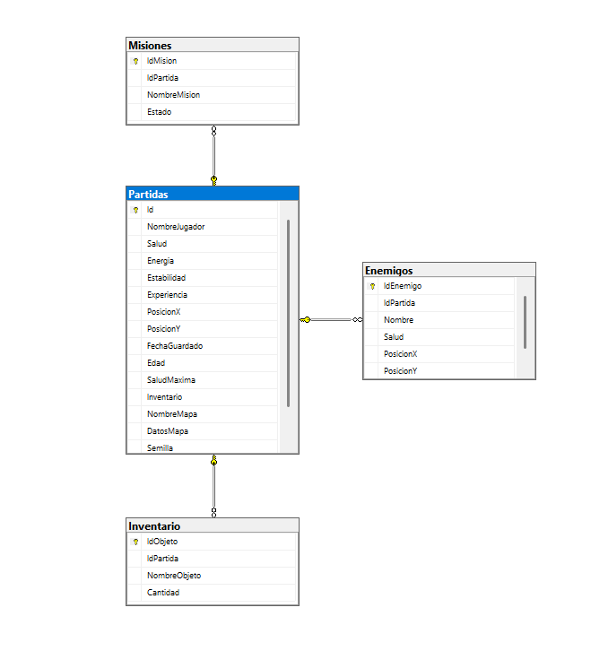
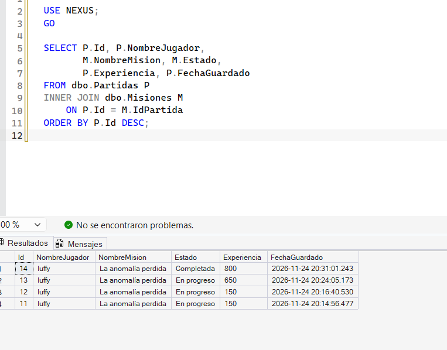
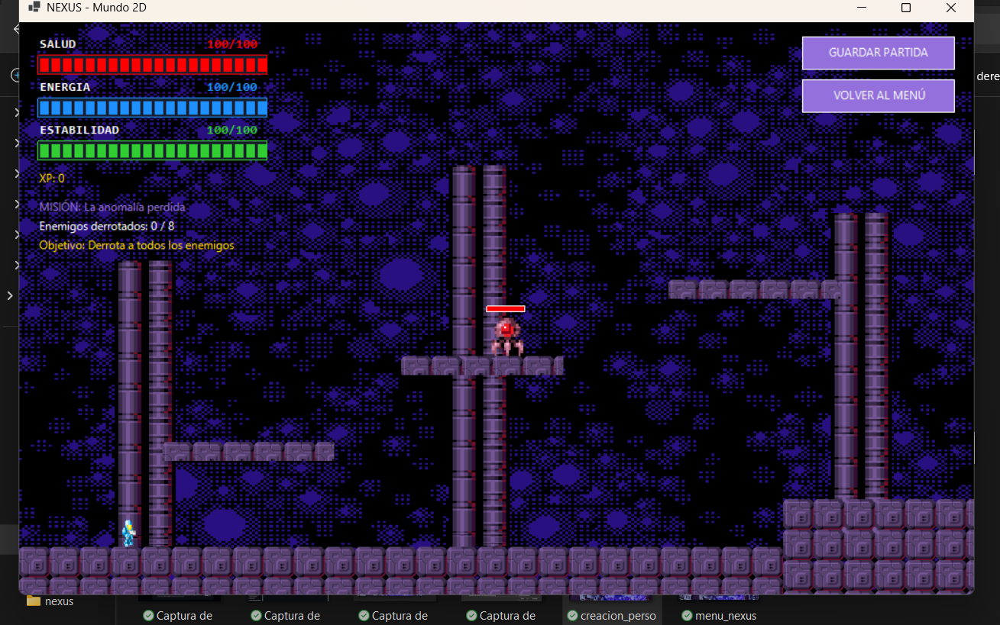

# Análisis técnico de alternativas para NEXUS

**Documento:** Análisis técnico del software  
**Versión:** 2.0  
**Proyecto:** NEXUS  
**Fecha de actualización:** 25 de noviembre de 2026  
**Estado:** Análisis de tecnologías implementadas y propuestas de mejora.

---

## 1. Introducción

NEXUS es un videojuego desarrollado mediante programación orientada a objetos en C#.

Durante H3, el proyecto funcionaba mediante una interfaz de consola, utilizando mapas matriciales, combate por turnos, administración de recursos y misiones.

La evolución del proyecto requirió investigar diferentes tecnologías para incorporar una interfaz gráfica, mejorar la experiencia del jugador y almacenar el progreso de manera persistente.

Inicialmente, se consideró utilizar WPF, MVVM y Entity Framework Core. Sin embargo, durante el desarrollo se implementaron Windows Forms, .NET 8 y Microsoft.Data.SqlClient para establecer la comunicación con SQL Server.

El presente documento analiza las alternativas tecnológicas, justifica las decisiones adoptadas y establece recomendaciones para futuras versiones de NEXUS.

---

## 2. Objetivo general

Analizar las alternativas tecnológicas disponibles para el desarrollo de NEXUS, considerando su viabilidad, mantenibilidad, rendimiento, persistencia y experiencia del usuario.

### 2.1. Objetivos específicos

- Comparar tecnologías de desarrollo de interfaces gráficas.
- Evaluar alternativas de arquitectura.
- Comparar mecanismos de acceso a datos.
- Justificar la utilización de SQL Server.
- Identificar riesgos y limitaciones técnicas.
- Establecer recomendaciones de mejora.
- Verificar la información obtenida mediante inteligencia artificial.

---

## 3. Criterios de evaluación

Las alternativas tecnológicas se evaluaron considerando los siguientes criterios:

| Criterio | Descripción |
|---|---|
| Viabilidad | Posibilidad de implementar la tecnología con los recursos disponibles |
| Compatibilidad | Integración con el código existente |
| Mantenibilidad | Facilidad para modificar y corregir el software |
| Rendimiento | Capacidad de responder a las acciones del jugador |
| Experiencia del usuario | Calidad de la interacción con el videojuego |
| Persistencia | Capacidad de almacenar y recuperar información |
| Escalabilidad | Posibilidad de incorporar nuevas funcionalidades |
| Complejidad | Esfuerzo necesario para aprender e implementar la tecnología |
| Costo | Recursos económicos y técnicos requeridos |

La selección busca equilibrar las necesidades del videojuego con el tiempo y los conocimientos disponibles durante el desarrollo individual.

---

## 4. Alternativas de interfaz gráfica

### 4.1. Aplicación de consola

Fue la tecnología utilizada durante H3.

**Ventajas:**

- Desarrollo inicial sencillo.
- Bajo consumo de recursos.
- Facilidad para probar algoritmos.
- Permite concentrarse en la lógica.
- Compatible con las clases originales.

**Desventajas:**

- Limitaciones gráficas.
- Interacción principalmente textual.
- Dificultad para incorporar animaciones.
- Experiencia visual limitada.
- Menor facilidad para representar escenarios dinámicos.

**Decisión:** conservar como antecedente del proyecto y referencia para las reglas originales.

### 4.2. Windows Forms

Windows Forms permite desarrollar aplicaciones gráficas de escritorio mediante C#.

**Ventajas:**

- Diseñador visual integrado en Visual Studio.
- Disponibilidad de botones, etiquetas y formularios.
- Manejo de eventos.
- Compatibilidad con el código existente.
- Posibilidad de utilizar temporizadores.
- Representación gráfica mediante OnPaint.
- Integración con DataGridView.
- Comunicación con SQL Server mediante ADO.NET.

**Desventajas:**

- Dependencia del sistema operativo Windows.
- Requiere trabajo manual para implementar gráficos avanzados.
- No constituye un motor especializado de videojuegos.
- Puede generar acoplamiento entre interfaz y lógica si no se organiza correctamente.

**Decisión:** tecnología seleccionada e implementada en NEXUS.

### 4.3. WPF

Windows Presentation Foundation permite desarrollar interfaces gráficas utilizando XAML y herramientas de presentación avanzadas.

**Ventajas:**

- Interfaces personalizables.
- Disponibilidad de estilos y animaciones.
- Data binding.
- Compatibilidad con patrones como MVVM.
- Facilita determinadas formas de separación entre interfaz y comportamiento.

**Desventajas:**

- Requiere conocimientos adicionales de XAML.
- Mayor esfuerzo de adaptación.
- Dependencia de Windows.
- Requeriría reorganizar los formularios existentes.

**Decisión:** alternativa considerada durante la propuesta inicial, pero no seleccionada para la implementación actual.

### 4.4. Unity

Unity es un motor especializado en el desarrollo de videojuegos que permite utilizar C#.

**Ventajas:**

- Herramientas especializadas para videojuegos.
- Sistemas de animación.
- Física y detección de colisiones.
- Desarrollo de escenarios 2D y 3D.
- Posibilidad de ampliar las mecánicas del videojuego.

**Desventajas:**

- Mayor curva de aprendizaje.
- Requiere adaptar el proyecto existente.
- Mayor complejidad para una entrega académica de alcance limitado.
- Integración diferente de la interfaz y persistencia.

**Decisión:** alternativa para futuras versiones de mayor alcance.

### 4.5. Comparación general

| Tecnología | Ventaja principal | Desventaja principal | Decisión |
|---|---|---|---|
| Consola | Simplicidad | Limitaciones visuales | Antecedente |
| Windows Forms | Compatibilidad y facilidad de desarrollo | Gráficos avanzados manuales | Seleccionada |
| WPF | Interfaces personalizables | Mayor esfuerzo de adaptación | No priorizada |
| Unity | Herramientas especializadas para videojuegos | Requiere migración | Alternativa futura |

Windows Forms representa una solución viable para el alcance actual de NEXUS, debido a que permite reutilizar las clases existentes y desarrollar una interfaz gráfica funcional.

---

## 5. Justificación de Windows Forms

La selección de Windows Forms permitió incorporar funcionalidades gráficas sin reemplazar completamente la estructura desarrollada durante H3.

Actualmente, el repositorio contiene los siguientes formularios y componentes:

| Archivo | Función |
|---|---|
| menu_principal.cs | Menú principal |
| inicio_cadete.cs | Creación del personaje |
| juego2d.cs | Exploración y combate 2D |
| cargarpartidas.cs | Consulta y recuperación de partidas |

Windows Forms permite utilizar eventos del teclado, botones, temporizadores y métodos de representación gráfica.

En NEXUS, estas herramientas permiten implementar movimiento, saltos, ataques, enemigos, indicadores del personaje y operaciones de guardado.

La selección se considera adecuada para el alcance académico actual, aunque un motor especializado podría resultar más conveniente si el videojuego aumenta considerablemente su complejidad.

---

## 6. Selección de la plataforma .NET

El prototipo de H3 utilizaba .NET 10 según la documentación original.

La configuración actual del proyecto utiliza .NET 8 para Windows.

El archivo `ConsoleApp9.csproj` contiene:

```xml id="4p4m2k"
<OutputType>WinExe</OutputType>
<TargetFramework>net8.0-windows</TargetFramework>
<UseWindowsForms>true</UseWindowsForms>
```

Esta configuración permite desarrollar una aplicación gráfica de escritorio utilizando Windows Forms.

La decisión actual consiste en mantener la plataforma configurada en el proyecto, evitando una migración innecesaria durante la entrega.

Cualquier actualización futura deberá considerar la compatibilidad de los paquetes, los requisitos de ejecución y el ciclo de soporte de .NET.

---

## 7. Alternativas de arquitectura

### 7.1. Arquitectura concentrada

Consiste en mantener la mayor parte del código dentro de un único archivo o componente.

**Ventajas:**

- Desarrollo inicial rápido.
- Configuración sencilla.
- Adecuada para prototipos pequeños.

**Desventajas:**

- Elevado acoplamiento.
- Dificultad para mantener el código.
- Mayor posibilidad de introducir errores.
- Dificultad para realizar pruebas independientes.

Esta organización se encontraba presente durante el desarrollo inicial de NEXUS.

### 7.2. Arquitectura organizada mediante carpetas

Consiste en separar archivos y clases según sus responsabilidades dentro del mismo proyecto.

**Ventajas:**

- Mejor organización.
- Menor complejidad inicial.
- Facilita la identificación de componentes.
- Permite realizar una transición progresiva.

**Desventajas:**

- Las dependencias entre componentes pueden mantenerse.
- No garantiza una separación completa de responsabilidades.

**Decisión:** alternativa recomendada como primera etapa de reorganización.

### 7.3. Arquitectura por capas

Consiste en separar el software mediante componentes especializados.

Capas propuestas:

- Presentación.
- Aplicación.
- Dominio.
- Infraestructura y persistencia.

**Ventajas:**

- Menor acoplamiento.
- Mayor mantenibilidad.
- Facilita las pruebas.
- Permite reutilizar componentes.
- Facilita futuras ampliaciones.

**Desventajas:**

- Mayor cantidad de archivos.
- Requiere definir responsabilidades y dependencias.
- Puede introducir complejidad innecesaria si se aplica sin considerar el alcance.

**Decisión:** arquitectura recomendada para la evolución futura de NEXUS.

### 7.4. Comparación

| Arquitectura | Complejidad inicial | Mantenibilidad | Evaluación |
|---|---|---|---|
| Código concentrado | Baja | Baja | Adecuada para prototipos |
| Organización por carpetas | Baja a media | Media | Recomendada como transición |
| Arquitectura por capas | Media | Alta | Recomendada a futuro |

La implementación actual presenta una separación funcional entre formularios, lógica y acceso a datos, aunque todavía existen responsabilidades compartidas.

La arquitectura por capas constituye una propuesta de mejora y no debe presentarse como una separación completamente implementada.

---

## 8. Alternativas de acceso a datos

### 8.1. ADO.NET y Microsoft.Data.SqlClient

Permiten establecer conexiones y ejecutar consultas directamente sobre SQL Server.

**Ventajas:**

- Control directo de las consultas SQL.
- Utilización de parámetros.
- Administración explícita de transacciones.
- Facilidad para comprender las operaciones realizadas.
- Compatibilidad con SQL Server.
- Integración con Windows Forms.

**Desventajas:**

- Requiere escribir consultas manualmente.
- Requiere administrar conexiones.
- El mapeo entre objetos y registros debe implementarse.
- Puede aumentar la cantidad de código.

**Decisión:** tecnología seleccionada e implementada.

### 8.2. Entity Framework Core

Es una herramienta de mapeo objeto-relacional que facilita la comunicación entre clases de C# y bases de datos.

**Ventajas:**

- Mapeo entre entidades y tablas.
- Consultas mediante LINQ.
- Seguimiento de cambios.
- Administración de migraciones.
- Reducción de determinadas operaciones repetitivas.

**Desventajas:**

- Requiere conocimientos adicionales.
- Introduce dependencias y configuraciones.
- Es necesario seleccionar una versión compatible con .NET.
- Requeriría modificar el acceso a datos existente.

**Decisión:** alternativa evaluada, pero no utilizada en la implementación actual.

### 8.3. Archivos JSON

Permiten almacenar información mediante estructuras de texto.

**Ventajas:**

- Implementación sencilla.
- Fácil serialización de objetos.
- No requieren un servidor para almacenamiento local.

**Desventajas:**

- Dificultad para establecer relaciones.
- Menor capacidad para realizar consultas complejas.
- Requieren mecanismos adicionales de integridad.
- No sustituyen el requisito de persistencia mediante SQL Server.

**Decisión:** utilizado como mecanismo complementario de serialización, no como sistema principal de almacenamiento.

### 8.4. Comparación general

| Alternativa | Ventaja principal | Desventaja principal | Decisión |
|---|---|---|---|
| ADO.NET | Control directo de SQL | Mayor trabajo manual | Seleccionada |
| Entity Framework Core | Mapeo de entidades | Requiere adaptación | Alternativa futura |
| JSON | Serialización sencilla | Limitaciones relacionales | Complementaria |

---

## 9. Justificación de Microsoft.Data.SqlClient

El archivo `partidasSQL.cs` contiene la clase `PartidaSQL`, encargada de establecer la comunicación con SQL Server.

La implementación utiliza componentes como:

- SqlConnection.
- SqlCommand.
- SqlTransaction.
- SqlDataAdapter.
- DataTable.

El proyecto utiliza consultas parametrizadas para registrar y recuperar información.

También utiliza transacciones para agrupar el almacenamiento de partidas, inventarios, enemigos y misiones.

La elección de Microsoft.Data.SqlClient permite comprender y controlar directamente las operaciones realizadas sobre la base de datos.

Además, permite aplicar los conocimientos de C#, SQL Server y programación orientada a objetos desarrollados durante la asignatura.

---

## 10. Alternativas de almacenamiento

### 10.1. SQL Server Express LocalDB

**Ventajas:**

- Orientado al desarrollo local.
- Configuración relativamente sencilla.
- Adecuado para pruebas individuales.

**Desventajas:**

- No está orientado a funcionar como servidor remoto compartido.
- Puede requerir cambios en la configuración existente.

### 10.2. SQL Server Express

**Ventajas:**

- Permite utilizar bases de datos relacionales.
- Soporta claves primarias y foráneas.
- Permite ejecutar consultas SQL.
- Soporta transacciones.
- Puede administrarse mediante SSMS.
- Es adecuado para el alcance actual del proyecto.

**Desventajas:**

- Requiere instalación y configuración.
- Presenta límites de recursos propios de la edición Express.
- Depende de la disponibilidad de la instancia.

**Decisión:** motor seleccionado e implementado.

### 10.3. SQLite

**Ventajas:**

- Base de datos integrada en un archivo.
- No requiere un servidor independiente.
- Facilita la distribución de aplicaciones locales.

**Desventajas:**

- Requiere adaptar el código de acceso a datos.
- No corresponde al motor SQL Server solicitado para el proyecto.

**Decisión:** alternativa no priorizada.

### 10.4. SQL Server en red o servicios en la nube

**Ventajas:**

- Posibilidad de centralizar información.
- Acceso desde diferentes equipos.
- Facilita futuras funcionalidades multiusuario.

**Desventajas:**

- Requiere infraestructura y configuración adicional.
- Puede generar costos.
- Requiere medidas de seguridad adicionales.
- Introduce dependencia de la red.

**Decisión:** alternativa para futuras versiones.

---

## 11. Justificación de SQL Server

La base de datos implementada en NEXUS permite almacenar:

- Datos del cadete.
- Atributos del personaje.
- Experiencia.
- Coordenadas.
- Información del mundo.
- Inventario.
- Enemigos.
- Estado de las misiones.

El modelo utiliza cuatro tablas principales:

1. Partidas.
2. Inventario.
3. Enemigos.
4. Misiones.

La tabla Partidas se relaciona con las demás mediante claves foráneas.

La estructura permite conservar el progreso del jugador después de cerrar la aplicación.

La utilización de SQL Server también permite verificar directamente los registros mediante SQL Server Management Studio.

---

## 12. Análisis de las funcionalidades implementadas

| Funcionalidad | Tecnología utilizada | Estado |
|---|---|---|
| Menú principal | Windows Forms | Implementado |
| Creación del cadete | C# y Windows Forms | Implementado |
| Exploración 2D | Windows Forms y gráficos | Implementado |
| Movimiento | Eventos de teclado | Implementado |
| Actualización del escenario | Temporizador | Implementado |
| Combate | Lógica C# | Implementado |
| Enemigos | Clases C# | Implementado |
| Indicadores | Representación gráfica | Implementado |
| Inventario | Listas, JSON y SQL Server | Implementado |
| Misiones | Lógica C# y SQL Server | Implementado |
| Guardado | Microsoft.Data.SqlClient | Implementado |
| Recuperación | Consultas SQL | Implementado |
| Consulta de partidas | DataGridView | Implementado |
| Transacciones | SqlTransaction | Implementado |
| Separación completa de capas | Servicios y contratos | Propuesto |
| Pruebas automatizadas | MSTest o xUnit | Propuesto |

---

## 13. Análisis de rendimiento

El videojuego utiliza un temporizador para actualizar el escenario y procesar acciones durante la ejecución.

Las operaciones de representación gráfica incluyen:

- Dibujo del personaje.
- Dibujo de enemigos.
- Representación de plataformas.
- Actualización de indicadores.
- Representación del escenario.

Las operaciones SQL se realizan principalmente cuando el jugador solicita guardar o recuperar una partida.

Esto evita ejecutar consultas a la base de datos durante cada movimiento del personaje.

Como mejoras futuras se propone:

- Reducir operaciones innecesarias durante la actualización gráfica.
- Administrar correctamente los recursos gráficos.
- Evitar bloquear la interfaz durante operaciones SQL prolongadas.
- Evaluar operaciones asíncronas.
- Optimizar consultas cuando aumente la cantidad de partidas.
- Realizar mediciones de rendimiento.

No se presentan valores de FPS, consumo de memoria ni tiempos de respuesta, debido a que no se realizaron mediciones específicas para este documento.

---

## 14. Análisis de seguridad

### 14.1. Consultas parametrizadas

El código utiliza parámetros para enviar información a SQL Server.

Esta práctica reduce el riesgo de inyección SQL al evitar la concatenación directa de valores proporcionados por el usuario.

### 14.2. Autenticación integrada

La conexión actual utiliza la autenticación integrada de Windows.

Esto evita incluir un usuario y contraseña directamente en la cadena de conexión.

### 14.3. Transacciones

El almacenamiento utiliza transacciones para mantener la consistencia de los registros relacionados.

### 14.4. Validación de datos

Se recomienda reforzar las validaciones de:

- Nombre del jugador.
- Edad.
- Salud.
- Energía.
- Estabilidad.
- Experiencia.
- Cantidad de objetos.
- Estado de las misiones.

### 14.5. Configuración de conexión

La cadena de conexión se encuentra definida directamente en el código.

Se recomienda trasladarla a una configuración externa.

### 14.6. Certificados

La conexión actual utiliza `TrustServerCertificate=True`.

Esta configuración puede facilitar el desarrollo local, pero para un entorno de producción se recomienda utilizar certificados confiables y verificar la identidad del servidor.

---

## 15. Análisis de mantenibilidad

El proyecto utiliza clases, propiedades, métodos, herencia y abstracción.

Sin embargo, parte de la lógica se encuentra integrada en los formularios.

Por ejemplo, `juego2d.cs` contiene responsabilidades relacionadas con:

- Movimiento.
- Combate.
- Generación de enemigos.
- Representación gráfica.
- Misiones.
- Operaciones de guardado.

La concentración de responsabilidades puede dificultar futuras modificaciones.

Se recomienda extraer progresivamente estas reglas hacia clases y servicios independientes.

La propuesta se encuentra desarrollada en el documento:

[Arquitectura propuesta](arquitectura-propuesta.md)

---

## 16. Experiencia del usuario

La incorporación de Windows Forms permitió mejorar la presentación del videojuego respecto a la versión de consola.

Las mejoras incluyen:

- Menú gráfico.
- Escenarios 2D.
- Representación visual de personajes.
- Combate en tiempo real.
- Indicadores del personaje.
- Información del progreso de misión.
- Confirmaciones de guardado.
- Visualización de partidas almacenadas.

Como ampliaciones futuras se propone incorporar:

- Panel independiente de inventario.
- Panel independiente de misiones.
- Configuración de controles.
- Nuevos escenarios.
- Nuevos enemigos.
- Mayor variedad de objetivos.

Estas funcionalidades deberán implementarse progresivamente, priorizando la estabilidad del sistema.

---

## 17. Viabilidad técnica

El proyecto utiliza tecnologías compatibles con el entorno de desarrollo empleado durante la asignatura.

Los principales requisitos son:

- Sistema operativo Windows.
- Entorno de ejecución compatible con .NET 8.
- Visual Studio o herramientas de desarrollo .NET.
- SQL Server Express.
- Base de datos NEXUS.
- Dependencias NuGet del proyecto.

La utilización de Windows Forms y Microsoft.Data.SqlClient permite continuar desarrollando el proyecto sin realizar una migración completa.

SQL Server Express puede utilizarse sin adquirir una licencia comercial de las ediciones superiores, dentro de sus condiciones y limitaciones.

La viabilidad del proyecto se relaciona con la disponibilidad de los recursos, el alcance académico y las funcionalidades existentes.

---

## 18. Riesgos técnicos y medidas de prevención

| Riesgo | Consecuencia | Medida propuesta |
|---|---|---|
| Acoplamiento entre interfaz y lógica | Dificultad de mantenimiento | Separar responsabilidades |
| Error durante el guardado | Pérdida de progreso | Utilizar transacciones |
| SQL Server no disponible | Imposibilidad de guardar | Informar y permitir reintentar |
| Datos inconsistentes | Recuperación incorrecta | Validaciones y restricciones |
| Duplicación del inventario | Diferencias entre JSON y SQL | Definir una fuente principal |
| Configuración SQL fija | Problemas en otros equipos | Externalizar configuración |
| Cambios sin pruebas | Errores en funcionalidades existentes | Realizar verificaciones progresivas |
| Pérdida de código | Dificultad de recuperación | Utilizar Git y GitHub |
| Recursos gráficos no disponibles | Errores de representación | Verificar rutas y archivos |
| Exceso de funcionalidades | Retrasos en el desarrollo | Priorizar el alcance principal |

---

## 19. Decisiones tecnológicas finales

| Componente | Propuesta inicial | Decisión implementada |
|---|---|---|
| Lenguaje | C# | C# |
| Plataforma | .NET 10 | .NET 8 para Windows |
| Interfaz gráfica | WPF | Windows Forms |
| Arquitectura | MVVM y capas | Separación funcional con propuesta de capas |
| Acceso a datos | Entity Framework Core | Microsoft.Data.SqlClient |
| Base de datos | SQL Server LocalDB | SQL Server Express |
| Exploración | Mapas matriciales | Escenarios 2D |
| Combate | Por turnos | Tiempo real |
| Persistencia | Propuesta | Guardado y recuperación implementados |
| Control de versiones | Git y GitHub | Git y GitHub |

La evolución del proyecto demuestra que las decisiones iniciales pueden modificarse según la viabilidad y las necesidades identificadas durante la implementación.

---

## 20. Recomendaciones técnicas

1. Mantener Windows Forms para la versión actual.
2. Conservar las clases principales de C#.
3. Separar progresivamente la lógica de los formularios.
4. Mantener SQL Server como sistema de persistencia.
5. Conservar las consultas parametrizadas.
6. Mantener las transacciones durante el guardado.
7. Externalizar la cadena de conexión.
8. Mejorar las restricciones de la base de datos.
9. Revisar la duplicación del inventario.
10. Incorporar pruebas automatizadas.
11. Documentar los cambios mediante commits descriptivos.
12. Mantener actualizadas las evidencias del proyecto.
13. Verificar la compatibilidad de las dependencias antes de actualizar .NET.
14. Incorporar nuevas funcionalidades después de comprobar la estabilidad del sistema.

---

## 21. Verificación de información obtenida mediante IA

La inteligencia artificial se utilizó como herramienta de apoyo para:

- Comparar alternativas tecnológicas.
- Comprender conceptos de programación.
- Analizar posibles arquitecturas.
- Organizar la documentación.
- Proponer mejoras.
- Interpretar errores.
- Comprender las operaciones SQL.
- Elaborar diagramas técnicos.

La información generada mediante IA no debe considerarse automáticamente correcta.

Para verificar las recomendaciones se utilizan el código fuente, la configuración del proyecto, el script SQL, las evidencias de funcionamiento y la documentación técnica oficial.

### 21.1. Verificación mediante el repositorio

| Afirmación técnica | Evidencia utilizada | Resultado |
|---|---|---|
| NEXUS utiliza C# | Archivos .cs | Confirmado en el código |
| Utiliza .NET 8 | ConsoleApp9.csproj | Confirmado |
| Utiliza Windows Forms | Configuración y formularios | Confirmado |
| Utiliza Microsoft.Data.SqlClient | Referencias del proyecto | Confirmado |
| Existe una base de datos NEXUS | Script SQL y evidencias | Confirmado documentalmente |
| Existen cuatro tablas relacionadas | sql/nexus.sql | Confirmado |
| Utiliza claves foráneas | Restricciones del script SQL | Confirmado |
| Utiliza consultas parametrizadas | partidasSQL.cs | Confirmado |
| Utiliza transacciones | BeginTransaction, Commit y Rollback | Confirmado |
| Permite guardar partidas | GuardarPartida y evidencias | Implementación identificada |
| Permite recuperar partidas | CargarPartida y evidencias | Implementación identificada |
| Existe separación completa de capas | Revisión de la estructura | Todavía no implementada |
| Existen pruebas automatizadas | Revisión de la estructura | No identificadas |

### 21.2. Verificación mediante pruebas y evidencias

El proyecto dispone de evidencias relacionadas con:

- Ejecución del menú principal.
- Creación del personaje.
- Exploración del escenario.
- Combate.
- Misión completada.
- Guardado de partidas.
- Recuperación del progreso.
- Consultas en SQL Server.
- Relaciones entre tablas.

Estas evidencias se encuentran en:

[Carpeta de evidencias](evidencias/)

La revisión documental no sustituye la ejecución directa del videojuego.

### 21.3. Verificación mediante documentación oficial

Para contrastar las características generales de las tecnologías se identificaron fuentes oficiales de Microsoft y documentación técnica de Unity.

Las referencias se encuentran en el apartado de fuentes técnicas.

La consulta y comprobación de cada referencia externa deberá realizarse antes de adoptar nuevas tecnologías o versiones de paquetes.

### 21.4. Uso responsable de inteligencia artificial

La inteligencia artificial constituye una herramienta de apoyo y no reemplaza la comprensión del desarrollador.

El responsable del proyecto debe:

- Comprender el código utilizado.
- Verificar las recomendaciones.
- Comprobar el funcionamiento.
- Identificar errores.
- Diferenciar propuestas de funcionalidades implementadas.
- Evitar presentar resultados de pruebas no realizadas.
- Explicar las decisiones tecnológicas adoptadas.

---

## 22. Plan de pruebas técnicas

| Prueba | Resultado esperado |
|---|---|
| Compilación | El proyecto compila correctamente |
| Inicio de aplicación | Se muestra el menú principal |
| Creación del cadete | Se inicializa el personaje |
| Movimiento | El personaje responde a los controles |
| Combate | Se actualiza la salud de los enemigos |
| Recarga de energía | Se recupera energía sin superar el máximo |
| Misión | Se verifica el cumplimiento de objetivos |
| Conexión SQL | Se establece comunicación con NEXUS |
| Guardado | Se registra el progreso |
| Recuperación | Se reconstruye el estado guardado |
| Error de conexión | Se informa al usuario |
| Error durante una transacción | No se confirma un guardado parcial |
| Clonación limpia | Se restauran las dependencias y se compila el proyecto |

Este apartado representa un plan de verificación.

Las pruebas deben ejecutarse y documentarse individualmente para confirmar sus resultados.

---

## 23. Control de versiones

NEXUS utiliza Git y GitHub para registrar la evolución del proyecto.

El repositorio permite:

- Mantener el código fuente.
- Registrar modificaciones.
- Consultar versiones anteriores.
- Documentar decisiones.
- Almacenar evidencias.
- Facilitar la clonación del proyecto.

Se recomienda utilizar commits descriptivos para identificar los cambios realizados.

Ejemplos:

- Implementar interfaz gráfica del menú principal.
- Incorporar combate en tiempo real.
- Implementar guardado de partidas en SQL Server.
- Agregar recuperación de enemigos y misiones.
- Actualizar documentación técnica.

Repositorio público:

https://github.com/dragon-51/nexus

---

## 24. Evidencias técnicas

Las evidencias permiten respaldar la evolución del videojuego.

### 24.1. Modelo de datos



### 24.2. Registros almacenados



### 24.3. Exploración gráfica



Las demás capturas y diagramas se encuentran disponibles en:

[Consultar todas las evidencias](evidencias/)

---

## 25. Referencias internas

- [README principal](../README.md)
- [Configuración del proyecto](../ConsoleApp9.csproj)
- [Clases principales](../Program.cs)
- [Menú principal](../menu_principal.cs)
- [Juego 2D](../juego2d.cs)
- [Acceso a datos](../partidasSQL.cs)
- [Script SQL](../sql/nexus.sql)
- [Diseño del juego](diseno-del-juego.md)
- [Arquitectura actual](arquitectura-actual.md)
- [Arquitectura propuesta](arquitectura-propuesta.md)
- [Modelo de datos](modelo-de-datos-propuesto.md)

---

## 26. Fuentes técnicas de consulta

### Documentación oficial de Microsoft

1. [Windows Forms](https://learn.microsoft.com/en-us/dotnet/desktop/winforms/overview/)

2. [Windows Presentation Foundation](https://learn.microsoft.com/en-us/dotnet/desktop/wpf/overview)

3. [Programación orientada a objetos en C#](https://learn.microsoft.com/en-us/dotnet/csharp/fundamentals/object-oriented/)

4. [ADO.NET](https://learn.microsoft.com/en-us/dotnet/framework/data/adonet/)

5. [Microsoft.Data.SqlClient](https://learn.microsoft.com/en-us/sql/connect/ado-net/introduction-microsoft-data-sqlclient)

6. [SQL Server](https://learn.microsoft.com/en-us/sql/sql-server/)

7. [Claves primarias y foráneas](https://learn.microsoft.com/en-us/sql/relational-databases/tables/primary-and-foreign-key-constraints)

8. [Transacciones locales en ADO.NET](https://learn.microsoft.com/en-us/dotnet/framework/data/adonet/local-transactions)

9. [Entity Framework Core](https://learn.microsoft.com/en-us/ef/core/)

10. [Serialización JSON en .NET](https://learn.microsoft.com/en-us/dotnet/standard/serialization/system-text-json/overview)

11. [Control DataGridView](https://learn.microsoft.com/en-us/dotnet/desktop/winforms/controls/datagridview-control-windows-forms)

12. [SQL Server Express LocalDB](https://learn.microsoft.com/en-us/sql/database-engine/configure-windows/sql-server-express-localdb)

### Documentación adicional

13. [Unity Manual](https://docs.unity3d.com/Manual/index.html)

14. [Documentación de GitHub](https://docs.github.com/)

15. [Documentación de Git](https://git-scm.com/doc)

16. [Documentación de SQLite](https://www.sqlite.org/docs.html)

---

## 27. Conclusión

El análisis técnico permitió identificar diferentes alternativas para mejorar el videojuego NEXUS.

La selección de C#, .NET 8, Windows Forms, Microsoft.Data.SqlClient y SQL Server Express permitió evolucionar desde una aplicación de consola hacia un videojuego gráfico con escenarios 2D y almacenamiento persistente.

Windows Forms representa una alternativa viable para el alcance académico del proyecto, mientras que SQL Server permite conservar y recuperar la información del jugador mediante un modelo relacional.

La implementación actual constituye una base funcional para futuras ampliaciones.

Se recomienda continuar mejorando la separación de responsabilidades, la seguridad, la integridad de los datos y las pruebas automatizadas.

Las decisiones tecnológicas deben mantenerse relacionadas con las necesidades reales del videojuego, evitando incorporar herramientas que aumenten innecesariamente la complejidad.

La evolución de NEXUS demuestra la aplicación práctica de programación orientada a objetos, interfaces gráficas, bases de datos y control de versiones dentro de un proyecto de desarrollo de software.
