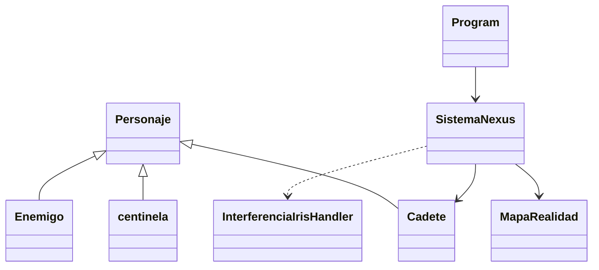

# Arquitectura actual de NEXUS (H3)

**Estado:** análisis del código disponible en la rama `main`.
**Archivos consultados:** `Program.cs`, `ConsoleApp9.csproj`, `README.md` y `docs/diseno-del-juego.md`.

## 1. Resumen

NEXUS H3 es una aplicación de consola desarrollada en C# sobre .NET 10. `Program.Main()` crea `SistemaNexus` y ejecuta `Ejecutar()`. La mayoría de clases y responsabilidades se concentran en `Program.cs`: modelo de personajes, mapa, reglas de exploración, combate, inventario, misión, entrada/salida por consola y comunicación TCP. En los archivos revisados no se encontró persistencia SQL ni funciones para guardar y recuperar partidas.

## 2. Clases reales

| Clase/elemento | Responsabilidad observada |
|---|---|
| `Personaje` (abstracta) | Define `Nombre`, `Salud`, `SaludMaxima` y `EjecutarAtaqueEnemigo()`. |
| `Cadete` | Hereda de `Personaje`; contiene edad, energía, estabilidad, experiencia, inventario y coordenadas `PosX`/`PosY`. |
| `centinela` | Enemigo con 70 puntos de salud y dos ataques aleatorios. Hereda de `Personaje`. |
| `Enemigo` | Representa al Infiltrado Kreeg, con 90 puntos de salud y ataques aleatorios. Hereda de `Personaje`. |
| `MapaRealidad` | Mantiene nombre y matriz `char[,]`; consulta/modifica celdas y renderiza el mapa con colores de consola. |
| `SistemaNexus` | Coordina inicio, validación, selección de realidad, panel, movimiento, eventos, combate, inventario, extracción y conexión TCP. |
| `Program` | Punto de entrada de la aplicación. |
| `InterferenciaIrisHandler` | Delegado usado por el evento estático `OnAnomaliaIris` para mostrar alertas. |

## 3. Funcionalidades comprobables

- Solicita nombre y edad del cadete; permite seleccionar Alpha, Beta o Gamma.
- Solicita energía y estabilidad iniciales entre 0 y 100. Rechaza el acceso si energía es menor que 50 o estabilidad menor que 20.
- `Cadete` inicia con salud 100, experiencia 0 y una célula de energía y un escudo. El constructor limita edad a 16–100 y energía/estabilidad a 0–100.
- Los mapas son matrices de caracteres definidas en `SeleccionarMatrizRealidad()`.
- El movimiento usa W, A, S y D; Q vuelve al panel. Se bloquean coordenadas fuera de la matriz y obstáculos `█`.
- `GatillarEventosCasilla()` detecta el núcleo `N`; en otras casillas puede iniciar combate (25 %), encontrar un objeto (15 %), causar pérdida de energía por radiación (10 %) o no producir evento (50 %).
- El combate por turnos permite atacar, usar un objeto o escapar. Al vencer al enemigo se obtienen 50 XP y una célula de energía.
- El inventario es una `List<string>` y permite consultar, utilizar y eliminar objetos.
- La entropía se calcula como `(100 - Estabilidad) * (100 - Energia)`. La sesión se interrumpe si supera 5600 o si la salud llega a cero.
- La extracción solo se completa después de encontrar el núcleo; entrega 100 XP.
- `ProcesarConexionIris()` intenta una conexión TCP a `192.168.40.11:5000`, envía el nombre del cadete y la realidad, y continúa en modo local si falla.

## 4. Configuración actual

`ConsoleApp9.csproj` declara `OutputType=Exe`, `TargetFramework=net10.0`, `ImplicitUsings` y `Nullable` habilitados. Incluye un paquete de herramientas de contenedores de Visual Studio. No aparecen referencias a WPF, Windows Forms, EF Core, SqlClient ni paquetes SQL. El README identifica C#, .NET 10, Visual Studio, Git y GitHub como tecnologías utilizadas.

## 5. Limitaciones reales

1. **Acoplamiento:** `SistemaNexus` concentra demasiadas responsabilidades.
2. **Interfaz mezclada con reglas:** se usan directamente `Console.WriteLine`, `Console.ReadKey`, `Console.Clear`, `ConsoleColor` y `Thread.Sleep`.
3. **Sin persistencia:** el estado solo existe en memoria; no se encontraron tablas, migraciones ni guardado/carga.
4. **Inventario débilmente tipado:** los objetos son cadenas y sus efectos se reconocen comparando textos.
5. **Misión simplificada:** `_misionCompletada` es un booleano; no existe historial ni entidad persistente de misión.
6. **Mapas estáticos:** las matrices están definidas en código.
7. **Invariantes incompletas:** aunque el constructor limita energía y estabilidad, los setters son públicos y algunas operaciones restan valores sin garantizar el rango 0–100.
8. **Red fija:** IP y puerto están escritos directamente en el código; la integración no está aislada como servicio.
9. **Pruebas difíciles:** consola, pausas y aleatoriedad están dentro de la lógica.
10. **Nombres:** `centinela` no sigue PascalCase; conviene renombrarla a `Centinela` al refactorizar.

## 6. Implicaciones

La evolución debe conservar las mecánicas de H3, pero extraerlas gradualmente a clases independientes. La interfaz debe dejar de controlar las reglas; la lógica no debe escribir en consola ni consultar SQL directamente. Antes de añadir funciones grandes, deben probarse movimiento, combate, inventario, entropía y misión.

## 7. Fuentes internas

- [Program.cs](../Program.cs)
- [ConsoleApp9.csproj](../ConsoleApp9.csproj)
- [README.md](../README.md)
- [Diseño del juego](diseno-del-juego.md)

**Verificación:** las afirmaciones se basan en los archivos consultados de la rama `main`. No se afirma que existan componentes que no aparecen en el código.
