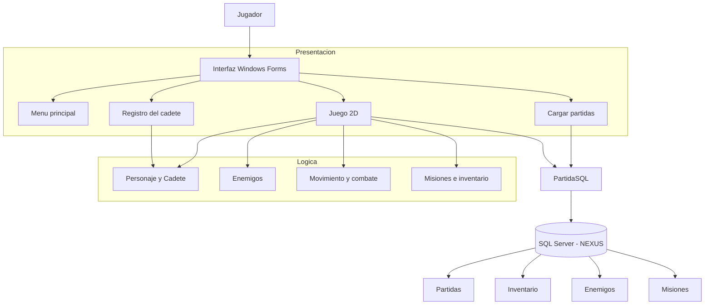
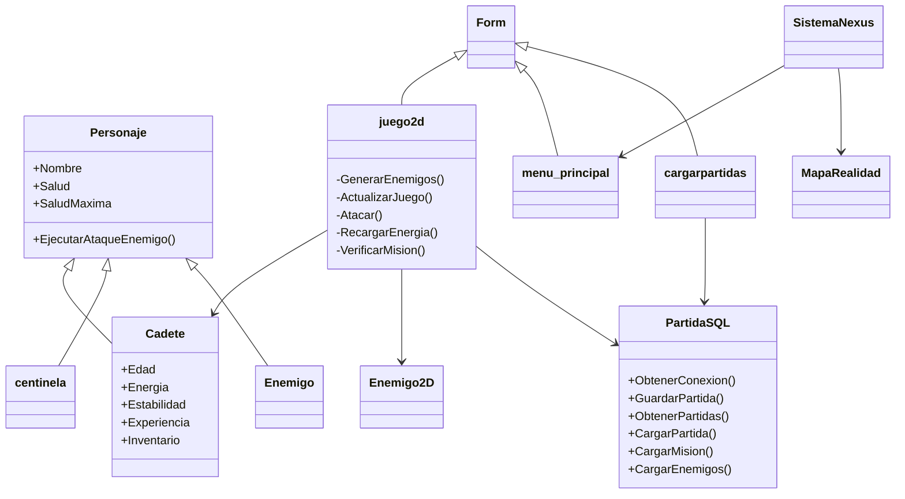
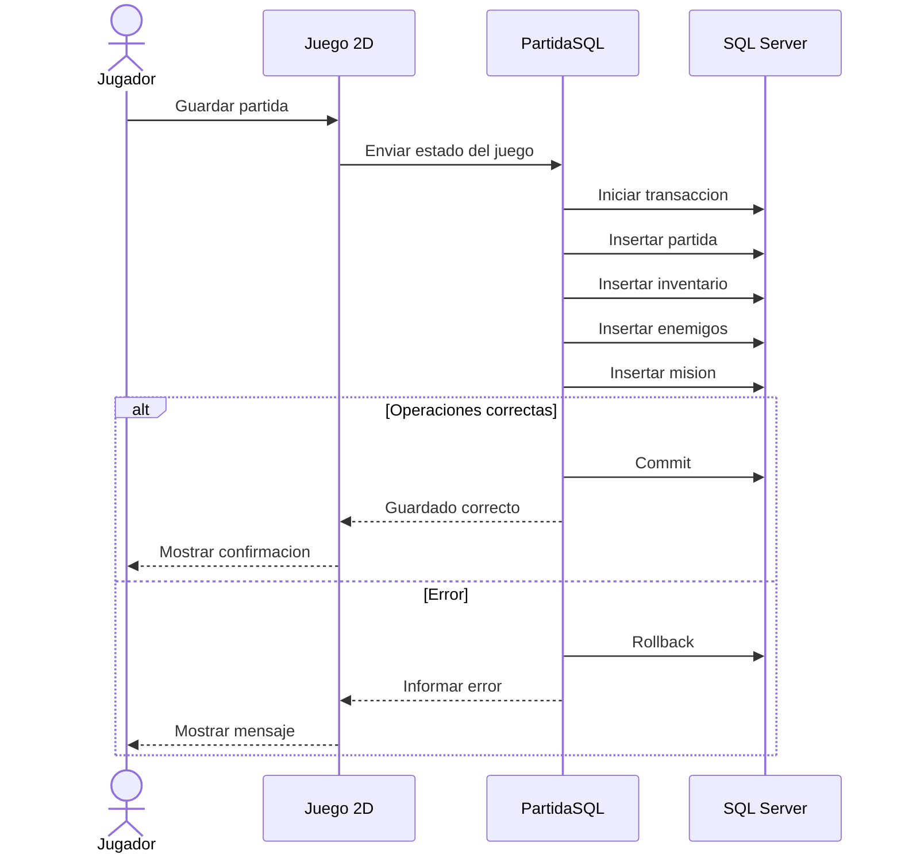

# Arquitectura actual de NEXUS

**Documento:** Arquitectura actual del software  
**Versión:** 2.0  
**Proyecto:** NEXUS  
**Estado:** Actualizado según el código fuente del repositorio GitHub.  
**Tecnologías:** C#, .NET 8, Windows Forms y SQL Server.

---

## 1. Introducción

NEXUS es un videojuego de exploración, acción y supervivencia desarrollado mediante programación orientada a objetos en C#.

Durante H3, el proyecto consistía en una aplicación de consola que incorporaba mapas matriciales, combate por turnos, administración de recursos y misiones.

Actualmente, NEXUS ha evolucionado hacia una aplicación gráfica desarrollada mediante Windows Forms, incorporando escenarios 2D, combate en tiempo real, animaciones, almacenamiento de partidas y recuperación del progreso mediante SQL Server.

La arquitectura actual conserva elementos del prototipo original y añade nuevos componentes para mejorar la experiencia del jugador.

---

## 2. Tecnologías utilizadas

| Tecnología | Función dentro del proyecto |
|---|---|
| C# | Lenguaje principal de programación |
| .NET 8 | Plataforma de ejecución |
| Windows Forms | Desarrollo de interfaces gráficas |
| SQL Server | Almacenamiento persistente |
| Microsoft.Data.SqlClient | Comunicación con la base de datos |
| Visual Studio | Desarrollo y depuración |
| Git | Control de versiones |
| GitHub | Almacenamiento y seguimiento del código fuente |
| SQL Server Management Studio | Administración de la base de datos |

El archivo `ConsoleApp9.csproj` establece la configuración del proyecto mediante `net8.0-windows`, habilitando Windows Forms.

También incluye la dependencia `Microsoft.Data.SqlClient` para realizar operaciones sobre SQL Server.

---

## 3. Estructura actual del proyecto

```text
NEXUS/
├── Program.cs
├── ConsoleApp9.csproj
├── ConsoleApp9.slnx
├── menu_principal.cs
├── menu_principal.Designer.cs
├── inicio_cadete.cs
├── juego2d.cs
├── juego2d.Designer.cs
├── enemigo2d.cs
├── cargarpartidas.cs
├── cargarpartidas.Designer.cs
├── partidasSQL.cs
├── Properties/
├── Resources/
├── botones/
├── sprites/
├── sounds/
├── sql/
│   └── nexus.sql
├── docs/
│   ├── diseno-del-juego.md
│   ├── arquitectura-actual.md
│   ├── arquitectura-propuesta.md
│   ├── modelo-de-datos-propuesto.md
│   ├── analisis-tecnico.md
│   └── evidencias/
├── README.md
└── .gitignore
```

La estructura anterior representa los principales archivos y directorios del proyecto.

Los archivos de código contienen los formularios, clases, reglas del videojuego y operaciones de acceso a datos.

Las carpetas de recursos contienen los elementos gráficos y sonoros utilizados por la aplicación.

---

## 4. Organización de la arquitectura

La arquitectura actual puede describirse mediante cuatro grupos funcionales:

1. Presentación e interfaz gráfica.
2. Lógica del videojuego.
3. Acceso a datos.
4. Base de datos.

Estos grupos representan las responsabilidades existentes dentro del proyecto. Actualmente no constituyen capas completamente independientes, debido a que parte de la lógica del videojuego se encuentra integrada en los formularios.

### 4.1. Presentación e interfaz gráfica

La interfaz utiliza Windows Forms para gestionar la interacción entre el jugador y el videojuego.

| Archivo | Responsabilidad |
|---|---|
| `menu_principal.cs` | Presenta las opciones principales del videojuego |
| `inicio_cadete.cs` | Gestiona la creación del personaje y del mundo |
| `juego2d.cs` | Presenta el escenario, los controles y los indicadores |
| `cargarpartidas.cs` | Permite consultar y seleccionar partidas almacenadas |
| Archivos `.Designer.cs` | Configuración visual de los formularios |

Las interfaces permiten realizar acciones mediante botones, eventos del teclado y cuadros de diálogo.

### 4.2. Lógica del videojuego

La lógica se encuentra distribuida principalmente entre `Program.cs`, `juego2d.cs` y `enemigo2d.cs`.

Sus responsabilidades incluyen:

- Creación del cadete.
- Administración de atributos.
- Generación del escenario.
- Movimiento del personaje.
- Detección de colisiones.
- Combate en tiempo real.
- Generación y comportamiento de enemigos.
- Administración de recursos.
- Obtención de experiencia.
- Verificación de misiones.

La clase `juego2d` concentra una parte importante de las reglas del videojuego, además de su representación gráfica.

### 4.3. Acceso a datos

El acceso a datos se realiza mediante la clase `PartidaSQL`, ubicada en `partidasSQL.cs`.

Esta clase utiliza la biblioteca `Microsoft.Data.SqlClient` para comunicarse con SQL Server.

Sus responsabilidades principales son:

- Establecer conexiones.
- Guardar partidas.
- Consultar partidas almacenadas.
- Recuperar datos del jugador.
- Recuperar enemigos.
- Almacenar el inventario.
- Guardar y consultar el estado de las misiones.
- Administrar transacciones.

### 4.4. Base de datos

SQL Server permite conservar los datos del videojuego después de cerrar la aplicación.

La base de datos se denomina `NEXUS`.

Actualmente contiene cuatro tablas principales:

- `Partidas`.
- `Inventario`.
- `Enemigos`.
- `Misiones`.

La tabla `Partidas` se relaciona con las demás mediante claves foráneas.

---

## 5. Diagrama de arquitectura actual



El diagrama representa las dependencias funcionales del sistema.

El jugador interactúa con Windows Forms. Los formularios gestionan las acciones del usuario y utilizan las clases y métodos correspondientes.

Las operaciones de persistencia se realizan mediante `PartidaSQL`, que establece la comunicación con SQL Server.

---

## 6. Clases principales

### 6.1. Clase Personaje

Es una clase abstracta que establece características comunes de los personajes.

Contiene:

- Nombre.
- Salud.
- Salud máxima.
- Método abstracto `EjecutarAtaqueEnemigo()`.

Permite aplicar abstracción y herencia.

### 6.2. Clase Cadete

Hereda de `Personaje` y representa al personaje controlado por el jugador.

Contiene:

- Edad.
- Energía.
- Estabilidad.
- Experiencia.
- Inventario.
- Coordenadas.

La clase conserva los atributos principales del diseño desarrollado durante H3.

### 6.3. Clases centinela y Enemigo

Son clases derivadas de `Personaje` pertenecientes al sistema de combate original de H3.

Representan unidades hostiles que cuentan con atributos y comportamientos propios.

### 6.4. Clase Enemigo2D

Representa a los enemigos utilizados en el escenario gráfico.

Permite manejar información como:

- Nombre.
- Salud.
- Posición.
- Estado del enemigo.

Sus datos pueden almacenarse y recuperarse mediante SQL Server.

### 6.5. Clase MapaRealidad

Pertenece al diseño original de NEXUS.

Representa mapas mediante matrices bidimensionales de caracteres.

Aunque la versión gráfica utiliza escenarios 2D, esta clase permanece como parte del código desarrollado durante H3.

### 6.6. Clase SistemaNexus

Coordina componentes del proyecto original y participa en el inicio de la interfaz gráfica.

Conserva métodos relacionados con:

- Validación de entradas.
- Exploración.
- Combate por turnos.
- Inventario.
- Eventos de anomalías.
- Misiones.
- Comunicación TCP del prototipo.

Estas responsabilidades forman parte de la evolución histórica del proyecto y no todas se utilizan directamente en el escenario 2D.

### 6.7. Clase juego2d

Es uno de los componentes principales de la versión actual.

Hereda de `Form` y contiene la representación gráfica del videojuego.

Entre sus métodos principales se encuentran:

| Método | Responsabilidad |
|---|---|
| `GenerarEnemigos()` | Generar enemigos en el escenario |
| `RecuperarEnemigos()` | Recuperar enemigos almacenados |
| `ActualizarJuego()` | Actualizar el estado del videojuego |
| `Atacar()` | Ejecutar la acción de ataque |
| `RecargarEnergia()` | Recuperar energía utilizando recursos |
| `VerificarMision()` | Comprobar las condiciones de la misión |
| `OnPaint()` | Dibujar los elementos gráficos |
| `JuegoForm_KeyDown()` | Detectar teclas presionadas |
| `JuegoForm_KeyUp()` | Detectar teclas liberadas |

### 6.8. Clase PartidaSQL

Es responsable de la comunicación con SQL Server.

| Método | Responsabilidad |
|---|---|
| `ObtenerConexion()` | Crear una conexión SQL |
| `ProbarConexion()` | Comprobar la conexión |
| `GuardarPartida()` | Almacenar el progreso |
| `ObtenerPartidas()` | Consultar las partidas disponibles |
| `CargarPartida()` | Recuperar una partida seleccionada |
| `CargarMision()` | Consultar el estado de la misión |
| `CargarEnemigos()` | Recuperar los enemigos guardados |

---

## 7. Diagrama de clases principales



El diagrama representa las relaciones principales de herencia y dependencia existentes en el proyecto.

---

## 8. Aplicación de programación orientada a objetos

### 8.1. Clases y objetos

Las clases representan modelos y comportamientos del videojuego.

Durante la ejecución se crean objetos correspondientes al cadete, enemigos, formularios y otros componentes.

### 8.2. Encapsulamiento

Se utilizan propiedades, campos privados y modificadores de acceso para organizar los datos y las responsabilidades de cada clase.

### 8.3. Herencia

La clase `Cadete` y las clases de enemigos del prototipo original heredan características de `Personaje`.

Los formularios gráficos heredan de la clase `Form` de Windows Forms.

### 8.4. Polimorfismo

Las clases derivadas de `Personaje` pueden implementar comportamientos diferentes mediante la sobrescritura de métodos.

También se utiliza `override` en métodos de Windows Forms, como `OnPaint()`.

### 8.5. Abstracción

La clase abstracta `Personaje` define características y comportamientos comunes que deben implementar sus clases derivadas.

---

## 9. Funcionamiento del sistema

El funcionamiento general de NEXUS sigue el siguiente proceso:

1. Se inicia la aplicación.
2. Se presenta el menú principal.
3. El jugador selecciona una nueva partida o carga una existente.
4. Se crean o recuperan los datos del cadete.
5. Se inicializa el escenario 2D.
6. El jugador explora y combate enemigos.
7. El sistema actualiza los indicadores.
8. Se verifican las condiciones de la misión.
9. El jugador puede guardar su progreso.
10. Los datos se almacenan en SQL Server.

### 9.1. Eventos de Windows Forms

La aplicación utiliza eventos para responder a las acciones del jugador.

Entre ellos se encuentran:

- Eventos Click de los botones.
- Eventos KeyDown y KeyUp.
- Eventos de actualización mediante temporizador.
- Eventos de representación gráfica.
- Eventos de cierre de formularios.

Estos eventos permiten mantener la interacción en tiempo real.

---

## 10. Arquitectura de persistencia

El sistema utiliza acceso directo a SQL Server mediante ADO.NET y la biblioteca `Microsoft.Data.SqlClient`.

### 10.1. Conexión

La conexión se establece mediante `SqlConnection`.

El proyecto utiliza una instancia local de SQL Server Express denominada `SQLEXPRESS`.

La autenticación se realiza mediante la seguridad integrada de Windows.

### 10.2. Guardado de partidas

El método `GuardarPartida()` registra los datos del jugador y del mundo.

También guarda la información relacionada con:

- Inventario.
- Enemigos.
- Estado de misión.

Las consultas utilizan parámetros para enviar los valores correspondientes a SQL Server.

### 10.3. Transacciones

El guardado utiliza `SqlTransaction` para administrar las operaciones relacionadas.

Si las operaciones se completan correctamente, se ejecuta `Commit()`.

Si ocurre una excepción, se ejecuta `Rollback()` para evitar que la partida quede almacenada parcialmente.

### 10.4. Recuperación de partidas

El método `ObtenerPartidas()` consulta las partidas almacenadas.

Los registros se presentan mediante un control DataGridView.

Cuando el jugador selecciona una partida, el sistema recupera la información necesaria para reconstruir su progreso.

### 10.5. Diagrama de persistencia



---

## 11. Modelo de datos actual

La base de datos está organizada alrededor de la tabla `Partidas`.

| Tabla | Responsabilidad |
|---|---|
| Partidas | Almacena los atributos y progreso general del jugador |
| Inventario | Almacena objetos y cantidades |
| Enemigos | Almacena enemigos, salud y posiciones |
| Misiones | Almacena el nombre y estado de las misiones |

Las relaciones existentes son:

- Partidas 1:N Inventario.
- Partidas 1:N Enemigos.
- Partidas 1:N Misiones.

La estructura de la base de datos se encuentra definida en el archivo `sql/nexus.sql`.

---

## 12. Recursos gráficos y sonoros

El proyecto incorpora recursos externos para mejorar la presentación del videojuego.

La carpeta `sprites/` contiene recursos relacionados con:

- Personajes.
- Enemigos.
- Plataformas.
- Fondos.

La carpeta `sounds/` contiene recursos de audio.

Los recursos gráficos y sonoros complementan la interfaz desarrollada mediante Windows Forms.

---

## 13. Comparación con la arquitectura de H3

| Componente | Arquitectura H3 | Arquitectura actual |
|---|---|---|
| Interfaz | Consola | Windows Forms |
| Plataforma | .NET 10 | .NET 8 para Windows |
| Exploración | Matrices | Escenarios 2D |
| Combate | Por turnos | Tiempo real |
| Entrada | Consola | Eventos de teclado y botones |
| Persistencia | Datos en memoria | SQL Server |
| Inventario | Lista temporal | Datos persistentes |
| Enemigos | Objetos temporales | Recuperación desde SQL |
| Misiones | Estado en memoria | Estado persistente |
| Recursos visuales | Caracteres y colores | Sprites y gráficos |

La evolución mantiene la identidad del proyecto original y amplía sus capacidades mediante una interfaz gráfica y almacenamiento persistente.

---

## 14. Fortalezas de la arquitectura actual

- Aplicación de programación orientada a objetos.
- Incorporación de interfaces gráficas.
- Separación del acceso a datos mediante PartidaSQL.
- Uso de consultas parametrizadas.
- Implementación de transacciones.
- Almacenamiento de partidas.
- Recuperación del progreso.
- Uso de recursos gráficos.
- Control de versiones mediante Git y GitHub.
- Disponibilidad de documentación técnica y evidencias.

---

## 15. Limitaciones actuales

Aunque NEXUS cuenta con funcionalidades implementadas, todavía presenta oportunidades de mejora.

### 15.1. Acoplamiento entre interfaz y lógica

Parte de las reglas del videojuego se encuentran dentro de `juego2d.cs`.

Esto dificulta realizar modificaciones independientes en la interfaz y en la lógica.

### 15.2. Concentración de responsabilidades

Algunos archivos contienen múltiples clases y métodos.

Se recomienda distribuir progresivamente las responsabilidades en componentes independientes.

### 15.3. Dependencia de Windows

Windows Forms limita la ejecución gráfica del proyecto al sistema operativo Windows.

### 15.4. Configuración de SQL Server

La cadena de conexión se encuentra definida directamente en el archivo de acceso a datos.

Esto puede dificultar la ejecución en computadoras que utilicen otra instancia de SQL Server.

### 15.5. Inventario

El inventario conserva una representación basada en nombres de objetos.

Se recomienda evolucionar hacia una clase específica para representar los objetos y sus efectos.

### 15.6. Pruebas automatizadas

No se identificó un proyecto independiente de pruebas automatizadas en la estructura revisada.

La separación de la lógica facilitaría incorporar pruebas unitarias.

### 15.7. Progresión del videojuego

Actualmente el sistema se concentra en una misión principal.

La incorporación de misiones adicionales y nuevos exploradores constituye una posible ampliación.

### 15.8. Consistencia de los datos

El inventario dispone de una representación JSON y registros relacionados en SQL Server.

Se recomienda definir una fuente principal de información para evitar inconsistencias entre ambas representaciones.

---

## 16. Evidencias de implementación

Las evidencias del proyecto se encuentran disponibles en la carpeta:

[Consultar evidencias de NEXUS](evidencias/)

Entre ellas se incluyen:

- Menú principal.
- Creación del cadete.
- Exploración 2D.
- Combate.
- Indicadores del personaje.
- Misión completada.
- Guardado de partidas.
- Recuperación de partidas.
- Registros de SQL Server.
- Diagrama de arquitectura.
- Diagrama del modelo de datos.

---

## 17. Referencias al código fuente

- [Program.cs](../Program.cs)
- [Configuración del proyecto](../ConsoleApp9.csproj)
- [Menú principal](../menu_principal.cs)
- [Inicio del cadete](../inicio_cadete.cs)
- [Juego 2D](../juego2d.cs)
- [Enemigos 2D](../enemigo2d.cs)
- [Carga de partidas](../cargarpartidas.cs)
- [Acceso a datos](../partidasSQL.cs)
- [Script SQL](../sql/nexus.sql)
- [Diseño del juego](diseno-del-juego.md)
- [README principal](../README.md)

---

## 18. Conclusión

La arquitectura actual de NEXUS representa una evolución significativa respecto al prototipo desarrollado durante H3.

La incorporación de Windows Forms, escenarios 2D, combate en tiempo real y SQL Server permite ofrecer una experiencia gráfica con almacenamiento persistente del progreso.

Sin embargo, todavía es posible mejorar la mantenibilidad mediante una mayor separación entre presentación, lógica del videojuego y acceso a datos.

Estas mejoras serán consideradas en el documento de arquitectura propuesta.

La presente documentación se fundamenta en la revisión del código fuente de NEXUS y describe sus componentes existentes, diferenciándolos de las mejoras futuras.
