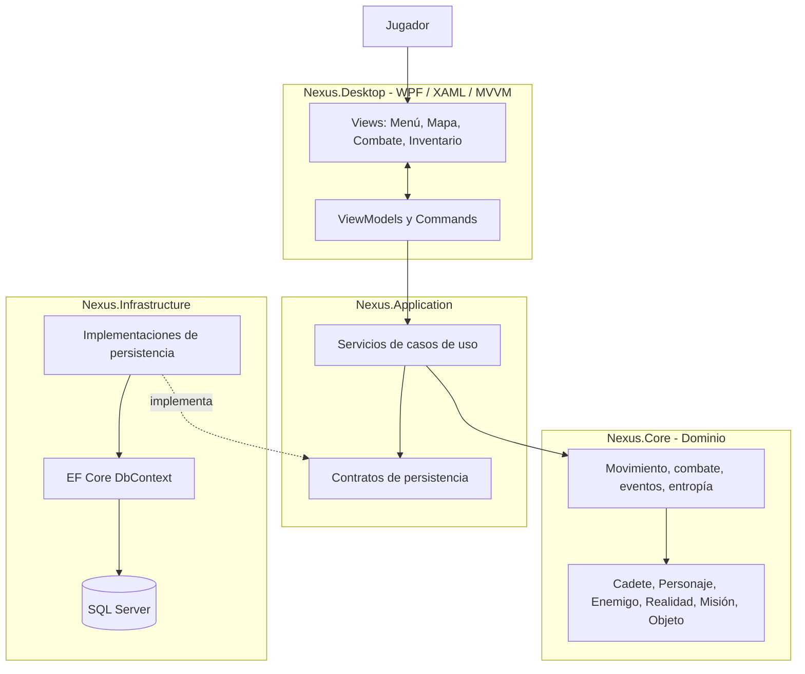

# Arquitectura propuesta para NEXUS

**Estado:** propuesta técnica, no implementada todavía. Base: `Program.cs`, `ConsoleApp9.csproj` y `docs/diseno-del-juego.md`.

## 1. Objetivo

Evolucionar la aplicación de consola a una aplicación gráfica de escritorio, manteniendo las mecánicas de H3. Se separan presentación, reglas del juego y acceso a datos. Así, cambiar una pantalla no obliga a reescribir combate o exploración, y cambiar SQL Server no afecta a la interfaz.

## 2. Tecnologías recomendadas

| Responsabilidad | Tecnología | Justificación |
|---|---|---|
| Interfaz gráfica | WPF + XAML sobre .NET 10 para Windows | Controles, estilos, data binding, layout, gráficos y animación. |
| Patrón de presentación | MVVM | Separa vistas de estado y comandos de presentación. |
| Dominio | Biblioteca C# `Nexus.Core` | Aloja personajes, cadete, enemigos, mapa y reglas sin depender de WPF. |
| Casos de uso | `Nexus.Application` | Coordina mover, combatir, usar objeto, completar misión y guardar/cargar. |
| Persistencia | EF Core 10 + `Microsoft.EntityFrameworkCore.SqlServer` | Mapeo de entidades, consultas LINQ y migraciones. |
| Base de datos | SQL Server Express LocalDB durante desarrollo | Adecuado para desarrollo individual en una PC; no es una base remota compartida. |
| Pruebas | xUnit o MSTest | Permite probar reglas sin abrir ventanas ni depender de SQL real en cada prueba. |

WPF solo funciona en Windows. La recomendación supone que el destino principal es Windows. Si se exige Linux o macOS, hay que reevaluar la tecnología de interfaz.

## 3. Diagrama de arquitectura



**Regla:** la interfaz no consulta SQL directamente. El dominio no conoce WPF, EF Core ni SQL Server. Infrastructure implementa los contratos que utiliza Application.

## 4. Estructura sugerida

```text
NEXUS/
├── src/
│   ├── Nexus.Desktop/        # WPF: Views, ViewModels, Resources
│   ├── Nexus.Application/    # Services, Contracts, DTOs
│   ├── Nexus.Core/           # Entities, Rules, Events
│   └── Nexus.Infrastructure/ # Persistence, Configurations
├── tests/
│   ├── Nexus.Core.Tests/
│   └── Nexus.Application.Tests/
└── docs/
```

Para una entrega pequeña se puede comenzar con `Nexus.Desktop` y `Nexus.Core`, y añadir Application e Infrastructure cuando se incorpore persistencia.

## 5. Correspondencia con H3

| Elemento actual | Destino | Adaptación |
|---|---|---|
| `Personaje`, `Cadete`, `centinela`, `Enemigo` | `Nexus.Core/Entities` | Conservar herencia; renombrar `centinela` a `Centinela`. |
| `MapaRealidad` | `Nexus.Core` | Mantener matriz y reglas, retirar llamadas a `Console`. |
| `SistemaNexus` | `Nexus.Application/Services` | Dividir en servicios de sesión, movimiento, combate, inventario y misión. |
| `MenuMovimiento()`, `MenuInventario()`, `ImprimirPanelEstadisticas()` | WPF Views y ViewModels | Mostrar estado y ejecutar comandos, sin reglas de negocio. |
| `IniciarFaseCombatePokemon()` y `GatillarEventosCasilla()` | Servicios/reglas de dominio | Devolver resultados sin imprimir mensajes ni esperar teclas. |
| `ProcesarConexionIris()` | Servicio opcional de integración | Sacar IP/puerto del código; no hacer que el juego dependa de esa conexión. |
| `Program.Main()` | Arranque de WPF | Configurar servicios y abrir ventana principal. |

## 6. Flujo de ejemplo: movimiento

1. El jugador pulsa una tecla o botón de movimiento.
2. El ViewModel ejecuta `MoveRightCommand`.
3. El comando llama a `GameSessionService.MoveAsync(Direction.Right)`.
4. El dominio comprueba límites y obstáculos, actualiza posición y devuelve el resultado.
5. El servicio actualiza estado y solicita persistir un punto de control cuando corresponda.
6. WPF actualiza mapa, barras e información mediante data binding.

La vista no calcula daño, entropía ni probabilidades, y no ejecuta SQL.

## 7. Guardado y recuperación

- Crear una expedición al iniciar una misión.
- Guardar después de cambios importantes: movimiento válido, objeto usado/recogido, combate terminado y misión completada.
- Guardar expedición, inventario y progreso de misión en una misma transacción.
- “Continuar” carga la última expedición `EnCurso`.
- Si SQL Server no está disponible, informar y ofrecer reintentar o iniciar modo local sin guardado.

## 8. Etapas

1. Extraer las clases de H3 a `Nexus.Core` y retirar dependencias directas de consola.
2. Crear pruebas para movimiento, colisiones, rangos 0–100, entropía, combate y recompensas.
3. Crear WPF con menú, mapa, panel vital, inventario y combate.
4. Añadir EF Core, entidades, `DbContext`, migración y servicios de guardar/cargar.
5. Probar partida completa, cerrar la aplicación y recuperar la partida.

## 9. Riesgos

- WPF requiere Windows: confirmar plataforma objetivo.
- No migrar interfaz y reglas al mismo tiempo: extraer y probar primero el dominio.
- No permitir acceso directo de ViewModels al DbContext.
- Mantener modo local si la base no está disponible.
- Dejar la red IRIS como integración opcional hasta definir su protocolo.

## 10. Fuentes técnicas

- [WPF overview (Microsoft Learn)](https://learn.microsoft.com/en-us/dotnet/desktop/wpf/overview)
- [WPF data binding (Microsoft Learn)](https://learn.microsoft.com/en-us/dotnet/desktop/wpf/data/)
- [Tutorial WPF con .NET 10 (Microsoft Learn)](https://learn.microsoft.com/es-es/dotnet/desktop/wpf/get-started/create-app-visual-studio)
- [Common .NET application architectures (Microsoft Learn)](https://learn.microsoft.com/en-us/dotnet/architecture/modern-web-apps-azure/common-web-application-architectures)
