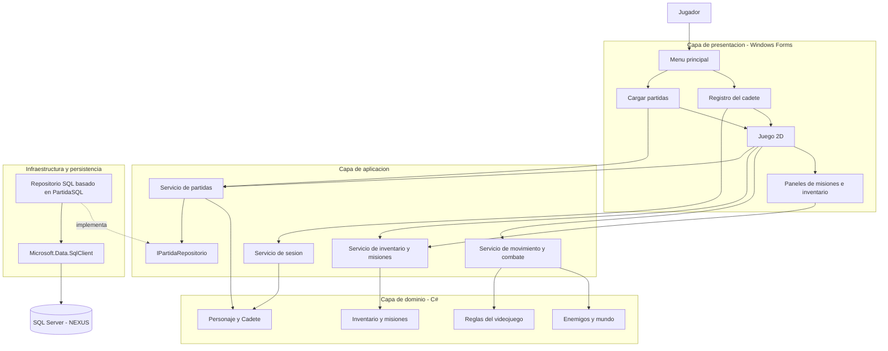
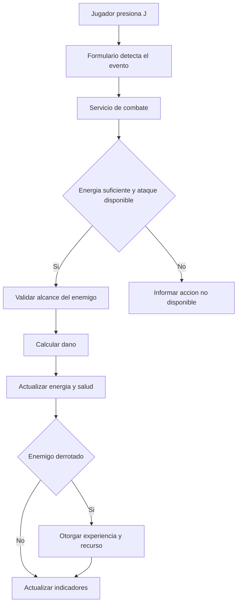
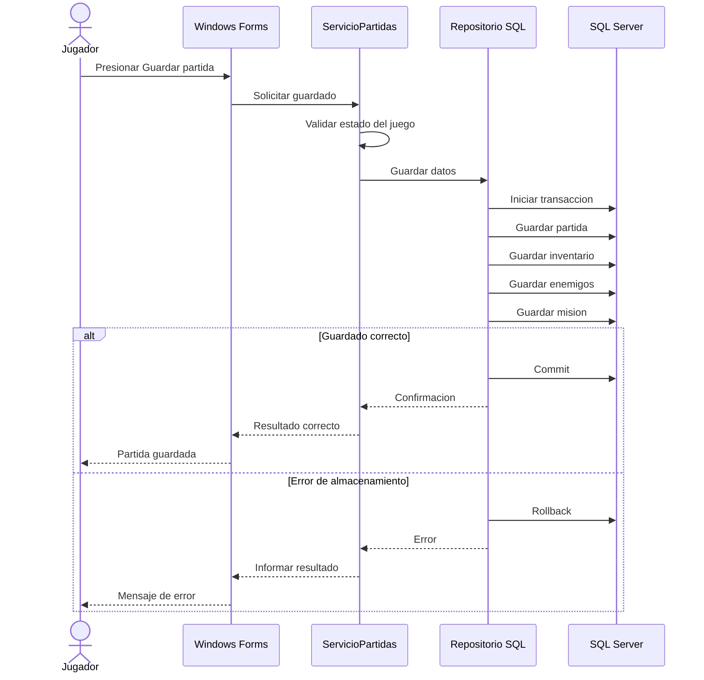

# Arquitectura propuesta para NEXUS

**Documento:** Arquitectura propuesta del software  
**Versión:** 2.0  
**Proyecto:** NEXUS  
**Estado:** Propuesta de mejora técnica basada en la implementación actual.  
**Tecnologías:** C#, .NET 8, Windows Forms y SQL Server.

---

## 1. Introducción

NEXUS comenzó como una aplicación de consola desarrollada durante H3, utilizando programación orientada a objetos, mapas matriciales, combate por turnos y administración de recursos.

La propuesta inicial contemplaba migrar hacia WPF y utilizar Entity Framework Core para la persistencia.

Sin embargo, durante la evolución del proyecto se decidió implementar una interfaz gráfica mediante Windows Forms y realizar el acceso a datos mediante Microsoft.Data.SqlClient.

Actualmente, el videojuego dispone de escenarios 2D, combate en tiempo real, misiones y almacenamiento persistente mediante SQL Server.

La nueva propuesta busca mejorar la organización interna del software sin reemplazar las funcionalidades que ya se encuentran implementadas.

---

## 2. Objetivo general

Diseñar una arquitectura modular para NEXUS que permita separar la interfaz gráfica, la lógica del videojuego y el acceso a datos, facilitando el mantenimiento, la ampliación y la realización de pruebas.

### 2.1. Objetivos específicos

- Separar las reglas del videojuego de los formularios.
- Conservar las clases desarrolladas mediante programación orientada a objetos.
- Mejorar la organización de los archivos.
- Centralizar las operaciones de acceso a datos.
- Garantizar la integridad de las partidas guardadas.
- Facilitar la incorporación de nuevas misiones y enemigos.
- Reducir el acoplamiento entre componentes.
- Facilitar la implementación de pruebas automatizadas.

---

## 3. Tecnologías seleccionadas

| Componente | Tecnología | Justificación |
|---|---|---|
| Lenguaje | C# | Permite aplicar programación orientada a objetos |
| Plataforma | .NET 8 | Mantiene la compatibilidad con el proyecto actual |
| Interfaz gráfica | Windows Forms | Aprovecha los formularios existentes |
| Lógica | Clases y servicios C# | Facilita la separación de responsabilidades |
| Acceso a datos | ADO.NET y Microsoft.Data.SqlClient | Permite controlar consultas y transacciones |
| Base de datos | SQL Server Express | Permite almacenar información de manera persistente |
| Administración SQL | SQL Server Management Studio | Facilita la gestión y verificación de registros |
| Control de versiones | Git y GitHub | Permite registrar la evolución del software |
| Pruebas futuras | MSTest o xUnit | Facilita la comprobación de las reglas del videojuego |

La propuesta conserva las tecnologías actuales para reducir el tiempo de desarrollo y evitar una migración innecesaria.

---

## 4. Arquitectura por capas

Se propone organizar NEXUS mediante cuatro capas principales:

1. Capa de presentación.
2. Capa de aplicación.
3. Capa de dominio.
4. Capa de infraestructura y persistencia.

La base de datos SQL Server actúa como sistema de almacenamiento.

Esta organización permitirá modificar componentes de manera independiente y reducir las dependencias innecesarias.

### 4.1. Capa de presentación

Será responsable de mostrar información y gestionar la interacción con el jugador.

Utilizará los formularios existentes de Windows Forms.

Componentes principales:

- Menú principal.
- Registro del cadete.
- Exploración 2D.
- Carga de partidas.
- Indicadores del personaje.
- Panel de misiones propuesto.
- Panel de inventario propuesto.

Archivos actuales relacionados:

- `menu_principal.cs`
- `inicio_cadete.cs`
- `juego2d.cs`
- `cargarpartidas.cs`

La interfaz deberá enviar las acciones del jugador a los servicios de aplicación y mostrar los resultados obtenidos.

Se propone evitar que los formularios concentren todas las reglas del videojuego.

### 4.2. Capa de aplicación

Será responsable de coordinar las operaciones realizadas por el jugador.

Se propone incorporar los siguientes servicios:

| Servicio propuesto | Responsabilidad |
|---|---|
| ServicioSesion | Administrar el inicio y cierre de partidas |
| ServicioMovimiento | Coordinar el desplazamiento del personaje |
| ServicioCombate | Procesar ataques y resultados |
| ServicioInventario | Administrar los recursos disponibles |
| ServicioMisiones | Coordinar objetivos y recompensas |
| ServicioPartidas | Coordinar el guardado y recuperación |

Estos servicios constituyen una propuesta de refactorización y todavía no existen como componentes independientes dentro del repositorio.

### 4.3. Capa de dominio

Contendrá las entidades y reglas principales del videojuego.

Se conservarán las clases existentes y se trasladarán progresivamente a componentes independientes.

Entidades principales:

- Personaje.
- Cadete.
- Enemigo.
- Enemigo2D.
- Mundo.
- Inventario.
- Misión.
- Partida.

Las entidades Mundo, Inventario, Misión y Partida representan posibles modelos independientes que deberán desarrollarse o reorganizarse durante la refactorización.

La capa de dominio será responsable de:

- Validar los atributos del personaje.
- Calcular el daño.
- Controlar la energía.
- Administrar la experiencia.
- Aplicar las reglas del combate.
- Verificar las condiciones de las misiones.
- Controlar los recursos.

El dominio no deberá depender directamente de Windows Forms ni de SQL Server.

### 4.4. Capa de infraestructura y persistencia

Será responsable de la comunicación con sistemas externos y el almacenamiento de información.

Se conservará la clase `PartidaSQL` como punto de partida para organizar las operaciones de persistencia.

Sus responsabilidades serán:

- Establecer conexiones SQL.
- Ejecutar consultas parametrizadas.
- Guardar partidas.
- Recuperar partidas.
- Administrar transacciones.
- Consultar enemigos.
- Consultar inventarios.
- Consultar estados de misiones.

Se propone incorporar una interfaz denominada `IPartidaRepositorio` para definir las operaciones de persistencia sin depender directamente de SQL Server desde la lógica del videojuego.

La implementación concreta podrá continuar utilizando Microsoft.Data.SqlClient.

---

## 5. Diagrama de arquitectura propuesta



El diagrama representa la arquitectura que se propone alcanzar mediante una reorganización progresiva del código.

La presentación utiliza los servicios de aplicación, los cuales coordinan las reglas del dominio y las operaciones de persistencia.

La infraestructura implementa los contratos de acceso a datos y establece la comunicación con SQL Server.

---

## 6. Estructura propuesta del repositorio

Se propone la siguiente organización futura:

```text
NEXUS/
├── src/
│   ├── Nexus.Presentation/
│   │   ├── Forms/
│   │   ├── Resources/
│   │   └── Program.cs
│   │
│   ├── Nexus.Application/
│   │   ├── Services/
│   │   ├── Contracts/
│   │   └── DTOs/
│   │
│   ├── Nexus.Domain/
│   │   ├── Entities/
│   │   ├── Rules/
│   │   └── Events/
│   │
│   └── Nexus.Infrastructure/
│       ├── Persistence/
│       ├── Repositories/
│       └── Configuration/
│
├── tests/
│   ├── Nexus.Domain.Tests/
│   └── Nexus.Application.Tests/
│
├── sql/
│   └── nexus.sql
│
├── docs/
│   ├── diseno-del-juego.md
│   ├── arquitectura-actual.md
│   ├── arquitectura-propuesta.md
│   ├── modelo-de-datos-propuesto.md
│   ├── analisis-tecnico.md
│   └── evidencias/
│
├── README.md
└── .gitignore
```

Esta estructura es una propuesta futura y no representa la organización física actual del repositorio.

Inicialmente, la separación puede realizarse mediante carpetas dentro del proyecto existente. Posteriormente, los componentes podrán convertirse en bibliotecas independientes de C#.

---

## 7. Correspondencia con el código actual

| Componente existente | Ubicación propuesta | Mejora |
|---|---|---|
| Personaje | Nexus.Domain | Conservar la clase abstracta |
| Cadete | Nexus.Domain | Centralizar la validación de atributos |
| centinela | Nexus.Domain | Conservar comportamiento y mejorar nomenclatura |
| Enemigo | Nexus.Domain | Organizar las reglas de enemigos |
| Enemigo2D | Nexus.Domain | Separar estado y comportamiento de la representación visual |
| MapaRealidad | Nexus.Domain | Separar datos del mapa de su representación |
| SistemaNexus | Nexus.Application | Dividir sus responsabilidades |
| menu_principal.cs | Nexus.Presentation | Conservar la interfaz |
| inicio_cadete.cs | Nexus.Presentation | Separar validación y presentación |
| juego2d.cs | Nexus.Presentation | Extraer las reglas del videojuego |
| cargarpartidas.cs | Nexus.Presentation | Delegar consultas al servicio de partidas |
| partidasSQL.cs | Nexus.Infrastructure | Centralizar persistencia |
| nexus.sql | sql/ | Conservar y mejorar el script de base de datos |

La reorganización deberá conservar las funcionalidades existentes y evitar introducir cambios innecesarios en el comportamiento del videojuego.

---

## 8. Propuesta de interfaces gráficas

### 8.1. Menú principal

Permitirá acceder a:

- Nueva partida.
- Cargar partida.
- Opciones.
- Salir.

Se conservará el menú gráfico existente y se podrán ampliar sus opciones posteriormente.

### 8.2. Exploración 2D

Mantendrá las funcionalidades actuales:

- Desplazamiento lateral.
- Plataformas.
- Saltos.
- Enemigos.
- Combate en tiempo real.
- Indicadores de salud, energía y estabilidad.
- Experiencia.
- Progreso de misión.
- Guardado de partidas.

La mejora consistirá en separar el dibujo del escenario de las reglas que modifican el estado del videojuego.

### 8.3. Panel de misiones

Se propone incorporar una pantalla independiente que permita consultar:

- Nombre de la misión.
- Objetivos.
- Enemigos derrotados.
- Estado.
- Recompensas.

Actualmente, el progreso de la misión se muestra dentro del escenario 2D.

### 8.4. Panel de inventario

Se propone incorporar una interfaz independiente para:

- Consultar objetos.
- Visualizar cantidades.
- Utilizar recursos.
- Consultar efectos.
- Administrar el equipamiento.

Actualmente, el inventario existe como parte del estado del cadete y permite utilizar células de energía mediante los controles del videojuego.

### 8.5. Carga de partidas

Se conservará la interfaz basada en DataGridView.

Se propone ampliar sus funcionalidades mediante:

- Búsqueda por nombre.
- Ordenamiento por fecha.
- Visualización del progreso.
- Eliminación de partidas con confirmación.
- Identificación de la última partida guardada.

Estas ampliaciones todavía no forman parte de las funcionalidades verificadas.

---

## 9. Flujo propuesto de combate



El objetivo es trasladar progresivamente las reglas del método `Atacar()` hacia un servicio independiente.

Se conservarán las condiciones actuales de consumo de energía, alcance, intervalo entre ataques y recompensas.

La interfaz gráfica deberá representar los resultados del combate sin concentrar todos los cálculos.

---

## 10. Flujo propuesto de guardado



La propuesta conserva el mecanismo de transacciones que ya se encuentra implementado en `PartidaSQL`.

La mejora principal consiste en incorporar un servicio de aplicación que coordine y valide el guardado antes de ejecutar las operaciones SQL.

---

## 11. Persistencia y modelo de datos

Se conservará SQL Server como sistema de almacenamiento.

La base de datos actual contiene:

- Partidas.
- Inventario.
- Enemigos.
- Misiones.

Se propone mantener estas tablas como base del sistema y mejorar progresivamente sus restricciones, validaciones y mecanismos de recuperación.

Las operaciones de persistencia deberán garantizar:

- Integridad referencial.
- Consultas parametrizadas.
- Uso de transacciones.
- Validación de información.
- Manejo de excepciones.
- Recuperación consistente del progreso.

El diseño detallado de las tablas se desarrolla en el documento `modelo-de-datos-propuesto.md`.

---

## 12. Seguridad y configuración

### 12.1. Consultas parametrizadas

Se conservará el uso de parámetros en las consultas SQL para evitar la concatenación directa de datos ingresados por el usuario.

### 12.2. Configuración de conexión

Se propone trasladar la cadena de conexión hacia un archivo de configuración externo.

Esto facilitará ejecutar NEXUS en computadoras con diferentes instancias de SQL Server.

### 12.3. Manejo de errores

Las operaciones deberán informar los errores mediante mensajes comprensibles.

Si SQL Server no está disponible, el sistema deberá evitar la pérdida silenciosa del progreso e informar que el guardado no pudo completarse.

### 12.4. Validación de datos

Se propone centralizar las validaciones de:

- Nombre del jugador.
- Edad.
- Salud.
- Energía.
- Estabilidad.
- Posición.
- Cantidad de objetos.
- Estado de misión.

---

## 13. Estrategia de pruebas

Se propone incorporar pruebas unitarias y de integración.

| Prueba | Resultado esperado |
|---|---|
| Creación del cadete | Atributos dentro de los rangos establecidos |
| Movimiento | Respeto de límites y obstáculos |
| Ataque | Consumo correcto de energía |
| Derrota de enemigo | Obtención de experiencia y recursos |
| Recarga de energía | No superar los 100 puntos |
| Misión | Recompensa únicamente al cumplir los objetivos |
| Guardado | Registro consistente de los datos |
| Recuperación | Restauración del progreso |
| Error SQL | Cancelación de la transacción |
| Inventario | Cantidades y recursos válidos |

Estas pruebas representan un plan de verificación futuro.

Las evidencias actuales de funcionamiento se encuentran en la carpeta `docs/evidencias/`.

---

## 14. Plan de implementación

### Etapa 1: Organización del código

- Identificar las responsabilidades existentes.
- Separar las clases de personajes.
- Organizar los recursos.
- Mantener la aplicación funcionando.

### Etapa 2: Separación de la lógica

- Extraer las reglas de combate.
- Extraer la administración del inventario.
- Separar las condiciones de las misiones.
- Centralizar las validaciones.

### Etapa 3: Servicios de aplicación

- Implementar servicios de sesión.
- Implementar servicios de combate.
- Implementar servicios de inventario.
- Implementar servicios de partidas.

### Etapa 4: Mejora de persistencia

- Incorporar contratos de acceso a datos.
- Externalizar la cadena de conexión.
- Mejorar las restricciones SQL.
- Conservar las transacciones existentes.

### Etapa 5: Ampliación de interfaces

- Incorporar el panel de misiones.
- Incorporar el panel de inventario.
- Mejorar la consulta de partidas.
- Mantener la identidad visual de NEXUS.

### Etapa 6: Verificación

- Ejecutar pruebas unitarias.
- Ejecutar pruebas de integración.
- Verificar el guardado y recuperación.
- Comprobar la compilación.
- Actualizar la documentación.
- Registrar los cambios mediante Git.

---

## 15. Ventajas de la arquitectura propuesta

- Mayor mantenibilidad.
- Menor acoplamiento.
- Mejor organización del código.
- Reutilización de componentes.
- Facilidad para incorporar nuevas funcionalidades.
- Mejor control de las operaciones SQL.
- Mayor facilidad para realizar pruebas.
- Reducción de errores durante futuras modificaciones.
- Conservación de las funcionalidades actuales.

---

## 16. Riesgos y medidas de prevención

| Riesgo | Medida propuesta |
|---|---|
| Introducir errores durante la reorganización | Realizar cambios pequeños y verificarlos |
| Perder funcionalidades existentes | Conservar pruebas y evidencias de funcionamiento |
| Aumentar la complejidad innecesariamente | Separar componentes de manera progresiva |
| Problemas de conexión SQL | Externalizar la configuración |
| Inconsistencia de datos | Mantener transacciones y restricciones |
| Dependencia de Windows | Documentar los requisitos de ejecución |
| Duplicación de información | Definir una fuente principal para cada dato |
| Dificultad para mantener el código | Aplicar responsabilidades claramente definidas |

---

## 17. Estado de implementación

| Componente | Estado |
|---|---|
| Interfaz Windows Forms | Implementado |
| Escenario gráfico 2D | Implementado |
| Programación orientada a objetos | Implementado |
| Combate en tiempo real | Implementado |
| Persistencia SQL Server | Implementado |
| Consultas parametrizadas | Implementado |
| Transacciones SQL | Implementado |
| Recuperación de partidas | Implementado |
| Separación completa de capas | Propuesto |
| Servicios independientes | Propuesto |
| Interfaz de repositorio | Propuesto |
| Panel independiente de inventario | Propuesto |
| Panel independiente de misiones | Propuesto |
| Pruebas automatizadas | Propuesto |

La tabla permite diferenciar las funcionalidades existentes de las mejoras planteadas para futuras versiones.

---

## 18. Evidencias

Las capturas y diagramas relacionados con la arquitectura y el funcionamiento del proyecto se encuentran en:

[Carpeta de evidencias de NEXUS](evidencias/)

Las evidencias muestran la implementación actual y sirven como referencia para la arquitectura propuesta.

El diagrama Mermaid del apartado 5 representa específicamente la organización futura recomendada.

---

## 19. Referencias internas

- [Arquitectura actual](arquitectura-actual.md)
- [Diseño del videojuego](diseno-del-juego.md)
- [Program.cs](../Program.cs)
- [Juego 2D](../juego2d.cs)
- [Acceso a datos](../partidasSQL.cs)
- [Configuración del proyecto](../ConsoleApp9.csproj)
- [Script SQL](../sql/nexus.sql)
- [README principal](../README.md)

## 20. Fuentes técnicas de consulta

- [Windows Forms - Microsoft Learn](https://learn.microsoft.com/en-us/dotnet/desktop/winforms/overview/)
- [Programación orientada a objetos en C#](https://learn.microsoft.com/en-us/dotnet/csharp/fundamentals/object-oriented/)
- [ADO.NET - Microsoft Learn](https://learn.microsoft.com/en-us/dotnet/framework/data/adonet/)
- [Microsoft.Data.SqlClient](https://learn.microsoft.com/en-us/sql/connect/ado-net/introduction-microsoft-data-sqlclient)
- [Transacciones locales en ADO.NET](https://learn.microsoft.com/en-us/dotnet/framework/data/adonet/local-transactions)
- [SQL Server - Microsoft Learn](https://learn.microsoft.com/en-us/sql/sql-server/)

---

## 21. Conclusión

La arquitectura propuesta para NEXUS busca mejorar la organización y mantenibilidad del videojuego sin reemplazar las tecnologías y funcionalidades existentes.

La separación entre presentación, aplicación, dominio e infraestructura permitirá ampliar el proyecto de manera progresiva, incorporar nuevas mecánicas y facilitar las pruebas.

La utilización de Windows Forms, C#, .NET 8 y SQL Server mantiene la compatibilidad con la implementación actual.

La propuesta constituye una evolución técnica viable del proyecto desarrollado durante H3 y establece una base para futuras versiones de NEXUS.
