# Diseño del videojuego NEXUS

**Documento:** Diseño del juego  
**Versión:** 2.0  
**Fecha de actualización:** 25 de noviembre de 2026  
**Base de diseño:** Proyecto NEXUS desarrollado durante H3.  
**Estado:** Diseño actualizado según la implementación actual y propuestas de mejora.

---

## 1. Visión del juego

### 1.1. Concepto

NEXUS Training System es un videojuego de ciencia ficción, acción, exploración y supervivencia en 2D.

El jugador asume el papel de un cadete perteneciente al sistema NEXUS, cuya responsabilidad consiste en explorar mundos desconocidos, enfrentarse a enemigos, administrar sus recursos y completar misiones.

El proyecto surge del prototipo desarrollado durante H3, que utilizaba una aplicación de consola en C#, mapas matriciales, eventos aleatorios y combate por turnos.

La versión actual evoluciona hacia una experiencia gráfica mediante Windows Forms, incorporando plataformas, movimiento, combate en tiempo real y persistencia mediante SQL Server.

### 1.2. Género

- Acción.
- Exploración.
- Supervivencia.
- Plataformas 2D.
- Ciencia ficción.

### 1.3. Papel del jugador

El jugador controla a un cadete encargado de explorar diferentes escenarios y superar los peligros presentes en el mundo.

Durante la partida deberá:

- Desplazarse por el escenario.
- Superar plataformas y obstáculos.
- Enfrentarse a enemigos.
- Administrar su salud y energía.
- Utilizar recursos del inventario.
- Obtener experiencia.
- Completar la misión principal.
- Guardar y recuperar su progreso.

### 1.4. Objetivo principal

El objetivo consiste en eliminar a los enemigos presentes en el escenario y alcanzar el final del mundo para completar la misión denominada **La anomalía perdida**.

### 1.5. Motivación del jugador

La motivación se basa en:

- Superar los desafíos del escenario.
- Mejorar el desempeño durante el combate.
- Obtener experiencia.
- Administrar los recursos disponibles.
- Completar objetivos.
- Conservar el progreso entre sesiones.
- Explorar futuras ampliaciones del videojuego.

---

## 2. Evolución desde H3

El diseño actual conserva la identidad y las clases principales del proyecto original, pero modifica la forma de interacción con el jugador.

| Elemento | Versión H3 | Versión actual |
|---|---|---|
| Interfaz | Consola | Windows Forms |
| Exploración | Matrices de caracteres | Escenarios 2D |
| Movimiento | W, A, S y D | A, D y espacio |
| Combate | Por turnos | Tiempo real |
| Personaje | Cadete | Cadete |
| Enemigos | Clases C# | Enemigos representados en 2D |
| Misiones | Búsqueda del núcleo | Eliminar enemigos y alcanzar el final |
| Inventario | Listas en memoria | Listas y persistencia SQL |
| Guardado | Sin persistencia SQL | SQL Server |
| Recursos gráficos | Caracteres y colores | Sprites y escenarios |
| Sonido | Limitado | Recursos de audio |

Las clases y reglas originales constituyen la base conceptual de la evolución del videojuego.

---

## 3. Ciclo principal del juego

El ciclo principal representa las acciones que realiza el jugador desde que inicia NEXUS hasta que completa una misión o abandona la partida.

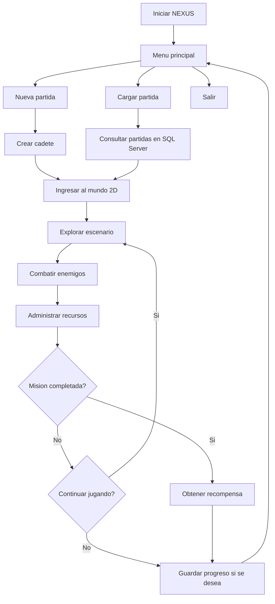

El jugador puede guardar la partida durante la exploración utilizando el botón correspondiente.

La recuperación permite continuar desde el estado almacenado en SQL Server.

---

## 4. Mecánicas y reglas

### 4.1. Creación del cadete

La clase `Cadete` representa al personaje controlado por el jugador.

Sus atributos principales son:

| Atributo | Función |
|---|---|
| Nombre | Identificación del jugador |
| Edad | Información del cadete |
| Salud | Estado físico actual |
| Salud máxima | Límite de salud |
| Energía | Recurso utilizado durante el combate |
| Estabilidad | Indicador del estado del personaje |
| Experiencia | Progreso obtenido |
| Inventario | Recursos disponibles |

La clase Cadete hereda de la clase abstracta Personaje, permitiendo reutilizar atributos y comportamientos definidos en el proyecto original.

### 4.2. Exploración del mundo

La exploración actual se realiza mediante un escenario de plataformas en 2D.

El jugador puede:

- Moverse horizontalmente.
- Saltar.
- Realizar un doble salto.
- Recorrer plataformas.
- Enfrentarse a enemigos.
- Avanzar hasta el final del escenario.

El archivo `juego2d.cs` contiene la lógica principal relacionada con el movimiento, la gravedad, las plataformas, las colisiones y la representación gráfica.

El escenario actual tiene un ancho lógico de 5000 unidades.

El sistema registra el nombre y la semilla del mundo. La distribución inicial de enemigos incorpora elementos aleatorios.

La recuperación de partidas utiliza las posiciones y estados de enemigos almacenados en SQL Server.

La generación completamente procedural de todas las plataformas constituye una posible mejora futura.

### 4.3. Controles

| Tecla | Acción |
|---|---|
| A | Moverse hacia la izquierda |
| D | Moverse hacia la derecha |
| Espacio | Saltar |
| Espacio durante el salto | Realizar doble salto |
| J | Atacar |
| R | Recargar energía |

Además, la interfaz dispone de botones para guardar la partida y regresar al menú.

### 4.4. Sistema de combate

El combate se desarrolla en tiempo real.

El jugador debe acercarse a los enemigos y utilizar la tecla J para atacar.

Reglas principales:

- Cada ataque requiere energía.
- El ataque consume 5 puntos de energía.
- Existe un intervalo entre ataques.
- El daño depende de las condiciones del ataque.
- Los enemigos pueden causar daño al cadete.
- El jugador obtiene experiencia al derrotar enemigos.
- Los enemigos derrotados pueden proporcionar células de energía.

La clase `Enemigo2D` representa a los enemigos presentes en el escenario.

La lógica del combate se encuentra principalmente en `juego2d.cs`.

### 4.5. Salud, energía y estabilidad

La salud representa la capacidad del cadete para sobrevivir a los ataques.

La energía permite ejecutar acciones de combate y debe administrarse durante la exploración.

La estabilidad representa un atributo heredado del sistema original de NEXUS.

El prototipo H3 utilizaba un cálculo de entropía relacionado con la energía y la estabilidad. La ampliación de este sistema dentro del combate gráfico constituye una posible mejora futura.

### 4.6. Inventario

El inventario permite almacenar los recursos del cadete.

Entre los objetos definidos en el proyecto se encuentran:

- Célula de energía.
- Escudo.

La célula de energía permite recuperar energía mediante la tecla R.

La recuperación incrementa la energía hasta un máximo de 100 puntos, siempre que exista una célula disponible.

El inventario se almacena mediante listas de C# y se conserva al guardar la partida en SQL Server.

La incorporación de una pantalla independiente para consultar y administrar todos los objetos constituye una mejora propuesta.

### 4.7. Experiencia

La experiencia representa el progreso del jugador.

Actualmente se obtiene mediante:

| Acción | Recompensa |
|---|---|
| Derrotar un enemigo | 50 XP |
| Completar la misión principal | 100 XP |

La experiencia se almacena en SQL Server y puede recuperarse al continuar una partida.

La incorporación de niveles, habilidades desbloqueables y mejoras de atributos constituye una ampliación futura.

---

## 5. Sistema de misiones

### 5.1. Misión principal: La anomalía perdida

**Descripción:** el cadete debe explorar el mundo, eliminar a los enemigos presentes y alcanzar el final del escenario.

**Objetivos:**

1. Ingresar al mundo.
2. Explorar las plataformas.
3. Enfrentarse a los enemigos.
4. Eliminar a todos los enemigos.
5. Alcanzar el final del escenario.
6. Obtener la recompensa correspondiente.

### 5.2. Condiciones de finalización

La misión se completa cuando:

- Todos los enemigos han sido derrotados.
- El jugador alcanza la zona final del escenario.
- La misión todavía no se encuentra completada.

Al cumplir estas condiciones, el sistema entrega 100 puntos de experiencia y muestra un mensaje de confirmación.

El estado de la misión se conserva en SQL Server para evitar que una misión ya completada vuelva a entregar la misma recompensa al recuperar la partida.

### 5.3. Estados de misión

| Estado | Descripción |
|---|---|
| En progreso | El jugador todavía no ha completado los objetivos |
| Completada | El jugador ha cumplido las condiciones de la misión |

### 5.4. Flujo de la misión

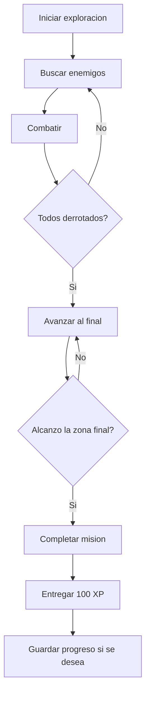

### 5.5. Evidencia de misión completada

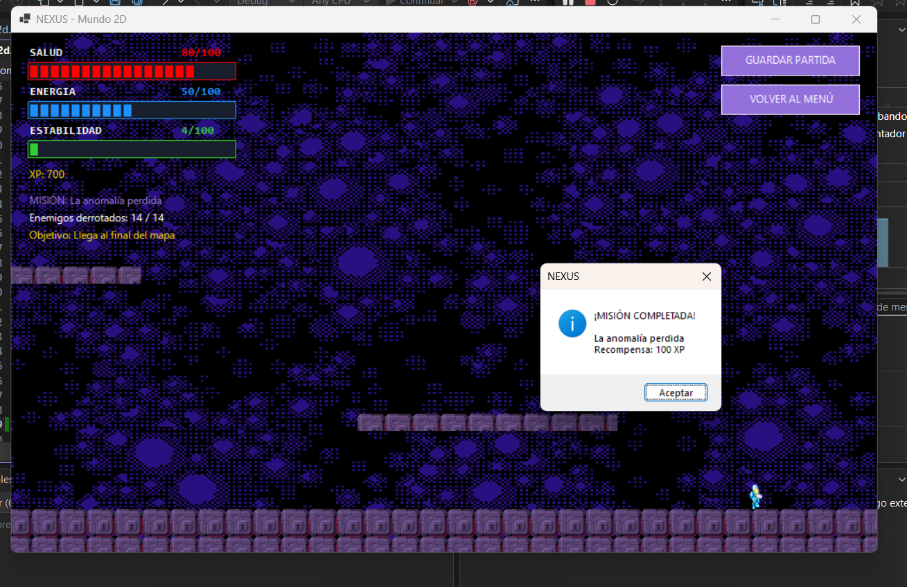

---

## 6. Diseño de pantallas y wireframes

Los siguientes bocetos representan la organización visual de las interfaces de NEXUS.

Se diferencia entre las pantallas implementadas y las propuestas para futuras versiones.

### 6.1. Pantalla 1: Menú principal

**Estado:** implementada.

**Objetivo:** permitir que el jugador acceda a las funciones principales del videojuego.

**Wireframe:**

```text
+--------------------------------------------+
|                                            |
|               N E X U S                    |
|             TRAINING SYSTEM                |
|                                            |
|           [ NUEVA PARTIDA ]                |
|                                            |
|           [ CARGAR PARTIDA ]               |
|                                            |
|           [    AJUSTES    ]                |
|                                            |
|           [     SALIR     ]                |
|                                            |
+--------------------------------------------+
```

**Elementos principales:**

- Título del videojuego.
- Botón de nueva partida.
- Botón de carga.
- Opción de ajustes.
- Botón de salida.
- Recursos gráficos y sonoros.

La ampliación de las funciones de ajustes puede realizarse en futuras versiones.

**Archivo relacionado:** `menu_principal.cs`.

**Evidencia real:**

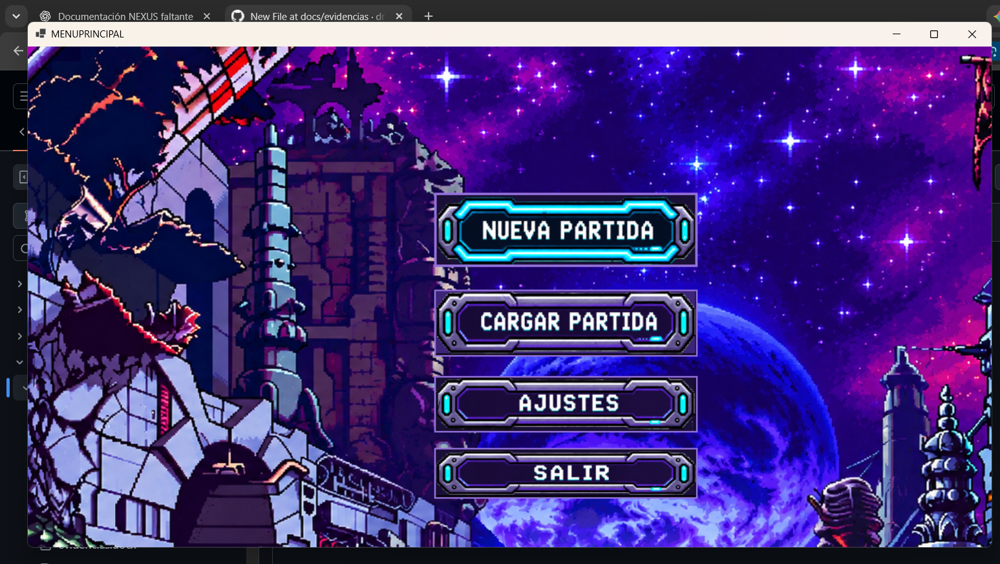

---

### 6.2. Pantalla 2: Exploración y mapa

**Estado:** implementada.

**Objetivo:** permitir que el jugador explore el mundo, combata y consulte sus estadísticas.

**Wireframe:**

```text
+------------------------------------------------------+
| NEXUS                    [GUARDAR] [VOLVER AL MENU]  |
|                                                      |
| Salud:       100/100                                 |
| Energia:      80/100                                 |
| Estabilidad:  60/100                                 |
| Experiencia:  150                                    |
|                                                      |
| Mision: La anomalia perdida                          |
| Objetivo: Derrotar a todos los enemigos              |
|                                                      |
|                 [ENEMIGO]                            |
|              ================                        |
|                                                      |
|    [CADETE]                    [ENEMIGO]             |
|  ===========                 ===========             |
|                                                      |
|======================================================|
| A/D: Moverse  ESPACIO: Saltar  J: Atacar  R: Energia  |
+------------------------------------------------------+
```

**Elementos principales:**

- Indicadores del cadete.
- Escenario de plataformas.
- Personaje.
- Enemigos.
- Información de misión.
- Botón de guardado.
- Botón de retorno.

**Archivo relacionado:** `juego2d.cs`.

**Evidencia real:**

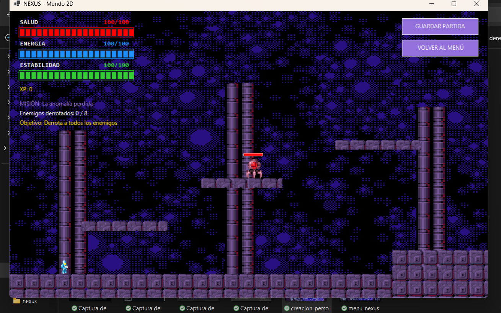

---

### 6.3. Pantalla 3: Panel de misiones

**Estado:** propuesta de ampliación.

La versión actual muestra información de la misión dentro del escenario.

Se propone incorporar un panel independiente para organizar los objetivos de manera más detallada.

**Wireframe:**

```text
+--------------------------------------------+
|              MISIONES NEXUS                |
+--------------------------------------------+
| Mision principal                           |
|                                            |
| LA ANOMALIA PERDIDA                        |
|                                            |
| Estado: En progreso                        |
|                                            |
| [X] Ingresar al mundo                      |
| [ ] Eliminar a todos los enemigos          |
| [ ] Alcanzar el final del escenario        |
|                                            |
| Recompensa: 100 XP                         |
|                                            |
|              [ CONTINUAR ]                 |
|              [  VOLVER   ]                 |
+--------------------------------------------+
```

**Elementos propuestos:**

- Nombre de misión.
- Descripción.
- Estado.
- Objetivos.
- Progreso.
- Recompensa.

La lógica de misión y su persistencia ya existen. El panel independiente todavía constituye una propuesta.

**Archivos relacionados:**

- `juego2d.cs`.
- `partidasSQL.cs`.
- `sql/nexus.sql`.

---

### 6.4. Pantalla 4: Explorador e inventario

**Estado:** propuesta de ampliación.

Actualmente, los atributos del cadete se muestran durante la exploración y el inventario se administra mediante la lógica de C#.

Se propone una pantalla independiente para consultar los recursos disponibles.

**Wireframe:**

```text
+--------------------------------------------+
|           EXPLORADOR E INVENTARIO          |
+--------------------------------------------+
| Nombre: Cadete NEXUS                       |
| Edad: 18                                   |
|                                            |
| Salud:       100/100                       |
| Energia:      80/100                       |
| Estabilidad:  60/100                       |
| Experiencia:  150 XP                       |
+--------------------------------------------+
| INVENTARIO                                 |
|                                            |
| Objeto                  Cantidad           |
| Celula de energia           3              |
| Escudo                      1              |
|                                            |
| [ UTILIZAR OBJETO ]                        |
|                                            |
| [ VOLVER AL JUEGO ]                        |
+--------------------------------------------+
```

Los valores mostrados son ejemplos de diseño y no corresponden a una partida específica.

**Elementos propuestos:**

- Datos del cadete.
- Estadísticas.
- Listado de objetos.
- Cantidades.
- Descripción de recursos.
- Acciones de uso.

**Archivos relacionados:**

- `Program.cs`.
- `juego2d.cs`.
- `partidasSQL.cs`.

**Evidencia de indicadores actuales:**

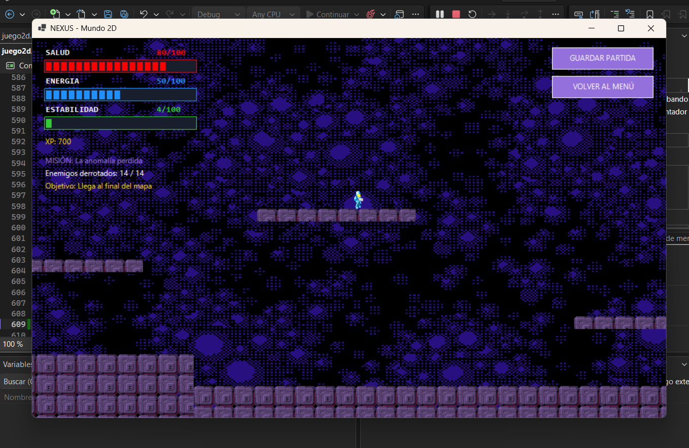

---

### 6.5. Pantalla 5: Carga de partidas

**Estado:** implementada.

**Objetivo:** permitir al jugador seleccionar y recuperar una partida almacenada.

**Wireframe:**

```text
+----------------------------------------------------+
|              PARTIDAS GUARDADAS                    |
+----------------------------------------------------+
| ID | Jugador | Mundo | Salud | XP  | Fecha          |
|----+---------+-------+-------+-----+----------------|
| 14 | Cadete  | Nexus | 100   | 800 | 24/11/2026     |
| 13 | Cadete  | Nexus |  80   | 650 | 24/11/2026     |
| 12 | Cadete  | Nexus |  50   | 150 | 24/11/2026     |
|                                                    |
| Seleccionar una partida mediante doble clic.       |
+----------------------------------------------------+
```

Los registros del boceto son ilustrativos.

La interfaz utiliza un control DataGridView para presentar la información obtenida de SQL Server.

**Archivos relacionados:**

- `cargarpartidas.cs`.
- `partidasSQL.cs`.

**Evidencia real:**

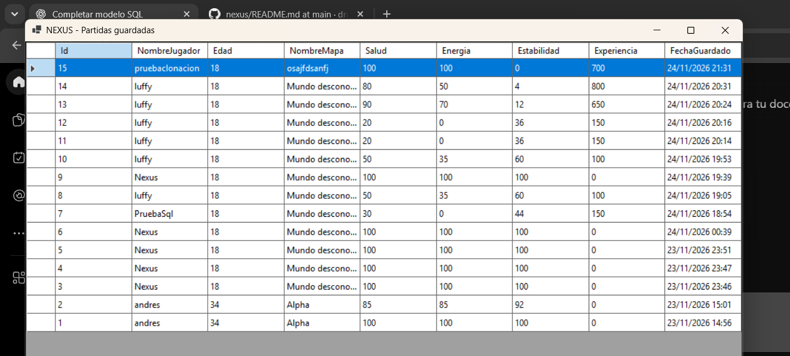

---

### 6.6. Pantalla adicional: Creación del cadete

**Estado:** implementada.

Permite ingresar los datos necesarios para comenzar una nueva partida y establecer el mundo de exploración.

**Archivo relacionado:** `inicio_cadete.cs`.

**Evidencia real:**

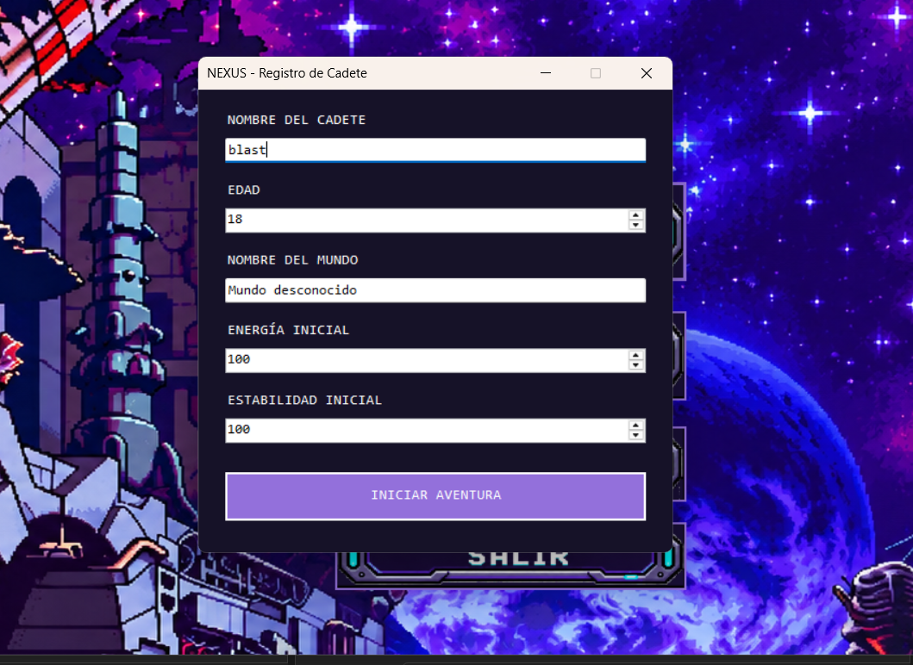

---

## 7. Navegación entre pantallas

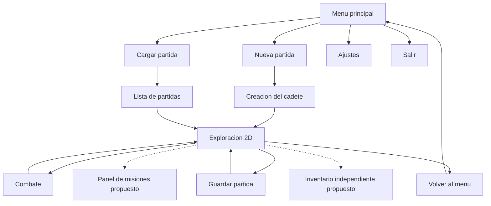

Las conexiones discontinuas representan ampliaciones propuestas.

---

## 8. Experiencia de usuario

### 8.1. Identidad visual

NEXUS utiliza una ambientación de ciencia ficción con elementos tecnológicos y futuristas.

La identidad visual busca mantener coherencia entre:

- Menú principal.
- Escenarios.
- Personajes.
- Enemigos.
- Indicadores.
- Botones.
- Recursos sonoros.

### 8.2. Legibilidad

La interfaz debe permitir que el jugador identifique fácilmente:

- Su salud.
- Su energía.
- Su estabilidad.
- Su experiencia.
- El objetivo actual.
- Los controles disponibles.

Los textos y elementos gráficos deben diferenciarse adecuadamente del fondo.

### 8.3. Jerarquía visual

La información se organiza según su importancia:

1. Estado de supervivencia del cadete.
2. Objetivo de misión.
3. Enemigos y obstáculos.
4. Recursos disponibles.
5. Acciones de navegación.

### 8.4. Facilidad de navegación

El jugador debe poder:

- Iniciar una partida desde el menú.
- Recuperar una partida almacenada.
- Identificar los controles.
- Guardar el progreso.
- Regresar al menú.

### 8.5. Retroalimentación

El videojuego debe informar al jugador sobre los resultados de sus acciones.

Actualmente se dispone de:

- Indicadores de estadísticas.
- Cambios en la salud de personajes.
- Representación de ataques.
- Progreso de misión.
- Mensajes de misión completada.
- Confirmaciones de guardado.
- Mensajes de error relacionados con la persistencia.

### 8.6. Mejoras de accesibilidad propuestas

- Configuración de controles.
- Ajustes de volumen.
- Mejora del contraste.
- Indicadores adicionales.
- Instrucciones iniciales.
- Mensajes más descriptivos.

Estas características se plantean como ampliaciones futuras.

---

## 9. Persistencia del progreso

### 9.1. Guardado

El jugador puede guardar su progreso mediante el botón Guardar partida.

El sistema registra información como:

- Nombre y edad.
- Salud.
- Energía.
- Estabilidad.
- Experiencia.
- Inventario.
- Posición del jugador.
- Nombre y semilla del mundo.
- Posición y salud de enemigos.
- Estado de la misión.
- Fecha de guardado.

Cada operación de guardado genera un registro de partida.

La implementación utiliza transacciones SQL para reducir el riesgo de guardar información parcialmente.

### 9.2. Recuperación

Desde el menú principal, el jugador puede acceder a la lista de partidas almacenadas.

Al seleccionar una partida, el sistema consulta SQL Server y reconstruye los atributos del cadete, su inventario, su posición, los enemigos y el estado de misión.

### 9.3. Modelo de almacenamiento

La base de datos NEXUS utiliza cuatro tablas:

| Tabla | Función |
|---|---|
| Partidas | Progreso general del jugador |
| Inventario | Objetos almacenados |
| Enemigos | Estado y posición de enemigos |
| Misiones | Estado de las misiones |

Para obtener mayor información:

[Consultar modelo de datos](modelo-de-datos-propuesto.md)

### 9.4. Evidencias

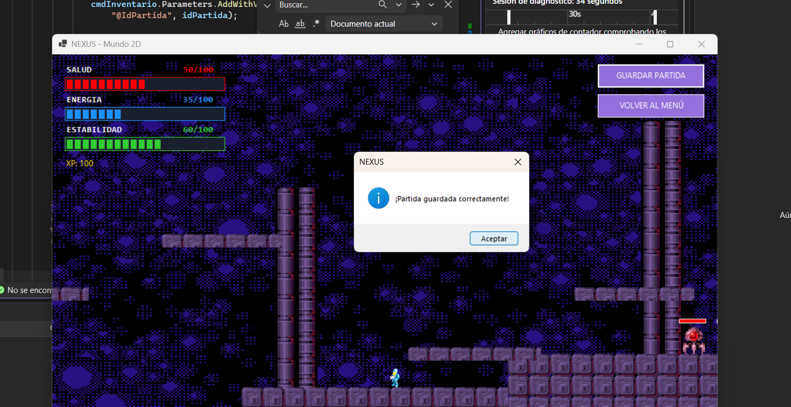

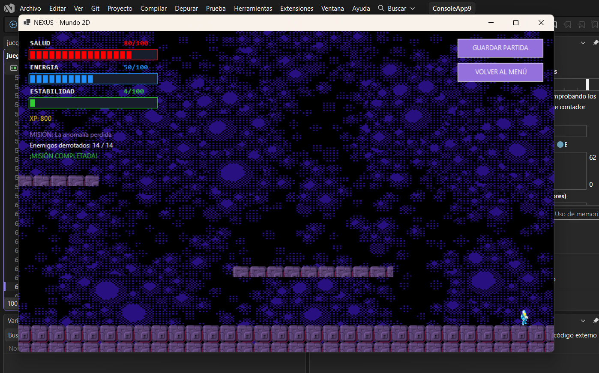

---

## 10. Alcance del videojuego

### 10.1. Funcionalidades implementadas

| Funcionalidad | Estado |
|---|---|
| Menú principal | Implementado |
| Creación del cadete | Implementado |
| Exploración 2D | Implementado |
| Movimiento horizontal | Implementado |
| Salto y doble salto | Implementado |
| Combate en tiempo real | Implementado |
| Enemigos | Implementado |
| Indicadores del personaje | Implementado |
| Experiencia | Implementado |
| Inventario | Implementado en la lógica |
| Recarga de energía | Implementado |
| Misión principal | Implementado |
| Guardado SQL | Implementado |
| Recuperación SQL | Implementado |
| Consulta mediante DataGridView | Implementado |

### 10.2. Funcionalidades futuras

| Funcionalidad | Prioridad |
|---|---|
| Panel independiente de inventario | Alta |
| Panel independiente de misiones | Alta |
| Separación de responsabilidades del código | Alta |
| Configuración de controles | Media |
| Nuevos tipos de enemigos | Media |
| Nuevas misiones | Media |
| Generación procedural completa de escenarios | Media |
| Sistema de niveles | Media |
| Habilidades desbloqueables | Media |
| Jefes finales | Baja |
| Modo multijugador | Baja |

Las funcionalidades futuras no deben considerarse implementadas hasta que exista código y evidencia de funcionamiento.

### 10.3. Restricciones

- El proyecto utiliza C#.
- La plataforma actual es .NET 8 para Windows.
- La interfaz gráfica utiliza Windows Forms.
- La persistencia requiere SQL Server.
- El desarrollo corresponde a un proyecto académico individual.
- Se prioriza la estabilidad antes de ampliar el alcance.
- Las mejoras deben mantener relación con el código existente.

---

## 11. Tecnologías relacionadas con el diseño

| Tecnología | Aplicación |
|---|---|
| C# | Lógica y comportamiento |
| .NET 8 | Plataforma de desarrollo |
| Windows Forms | Interfaz gráfica |
| Microsoft.Data.SqlClient | Acceso a datos |
| SQL Server Express | Persistencia |
| JSON | Serialización de información |
| Git | Control de versiones |
| GitHub | Repositorio y documentación |

Las decisiones tecnológicas se justifican en:

[Consultar análisis técnico](analisis-tecnico.md)

---

## 12. Correspondencia con el código fuente

| Archivo | Relación con el diseño |
|---|---|
| Program.cs | Clases originales y atributos del cadete |
| menu_principal.cs | Navegación principal |
| inicio_cadete.cs | Creación del personaje |
| juego2d.cs | Exploración, movimiento, combate y misión |
| enemigo2d.cs | Representación de enemigos |
| cargarpartidas.cs | Selección y recuperación de partidas |
| partidasSQL.cs | Persistencia |
| sql/nexus.sql | Modelo relacional |
| sprites/ | Recursos gráficos |
| sounds/ | Recursos de audio |

---

## 13. Evidencias del videojuego

### 13.1. Combate

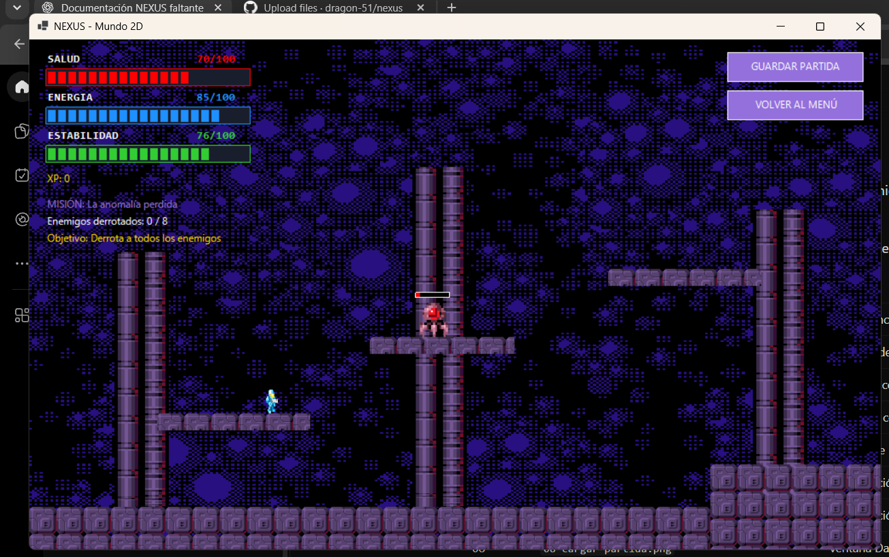

### 13.2. Base de datos

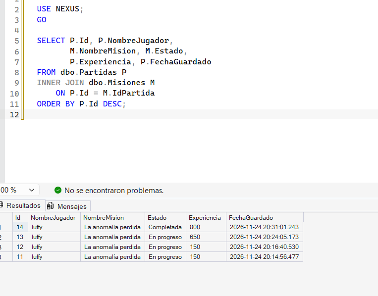

### 13.3. Modelo relacional

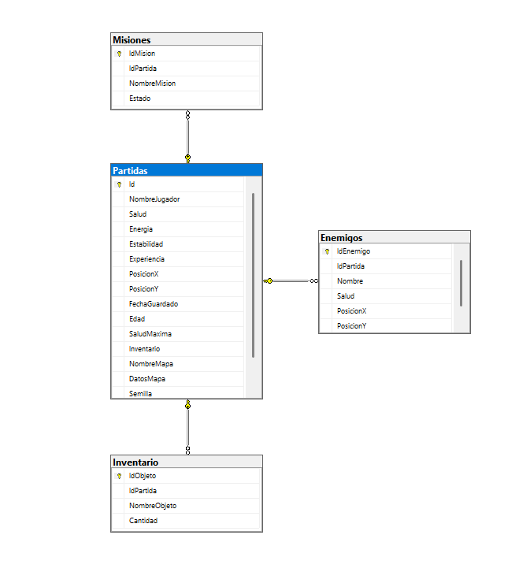

Las capturas corresponden a evidencias publicadas del desarrollo del proyecto.

[Consultar todas las evidencias](evidencias/)

---

## 14. Documentación relacionada

- [README principal](../README.md)
- [Arquitectura actual](arquitectura-actual.md)
- [Arquitectura propuesta](arquitectura-propuesta.md)
- [Modelo de datos propuesto](modelo-de-datos-propuesto.md)
- [Análisis técnico](analisis-tecnico.md)
- [Código principal](../Program.cs)
- [Juego 2D](../juego2d.cs)
- [Acceso a datos](../partidasSQL.cs)
- [Script SQL](../sql/nexus.sql)

---

## 15. Conclusión

NEXUS evolucionó desde una aplicación de consola desarrollada durante H3 hacia un videojuego gráfico de exploración, acción y supervivencia en 2D.

El diseño actual conserva elementos fundamentales del proyecto original, como el cadete, los enemigos, los recursos, la experiencia y las misiones.

La incorporación de Windows Forms permitió mejorar la interacción visual, mientras que SQL Server permitió conservar y recuperar el progreso del jugador.

Los wireframes presentados describen tanto las interfaces existentes como las ampliaciones propuestas, diferenciando claramente el estado de cada funcionalidad.

La evolución futura deberá priorizar la mantenibilidad, la experiencia del usuario, la estabilidad y la incorporación progresiva de nuevas mecánicas.
