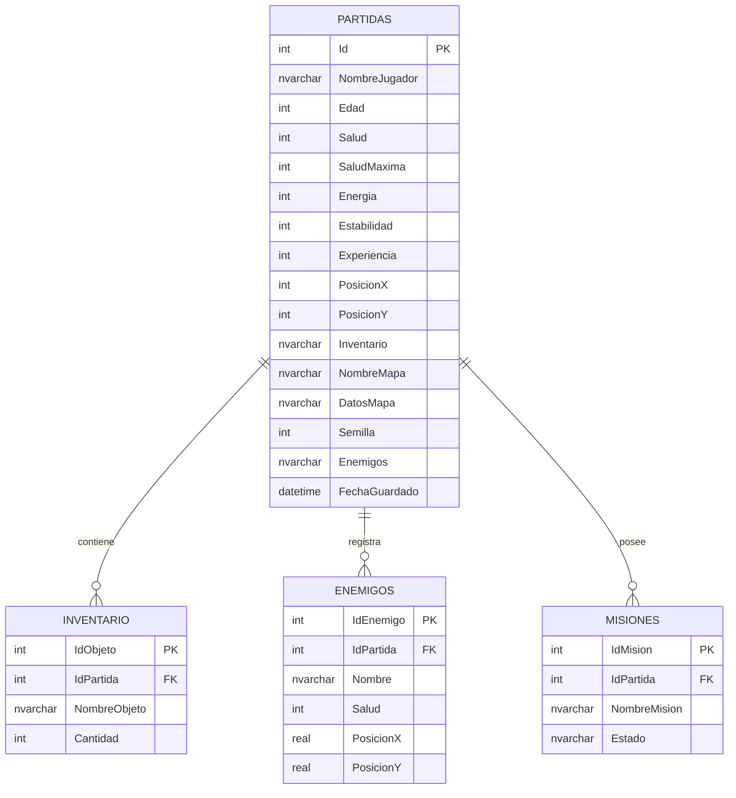
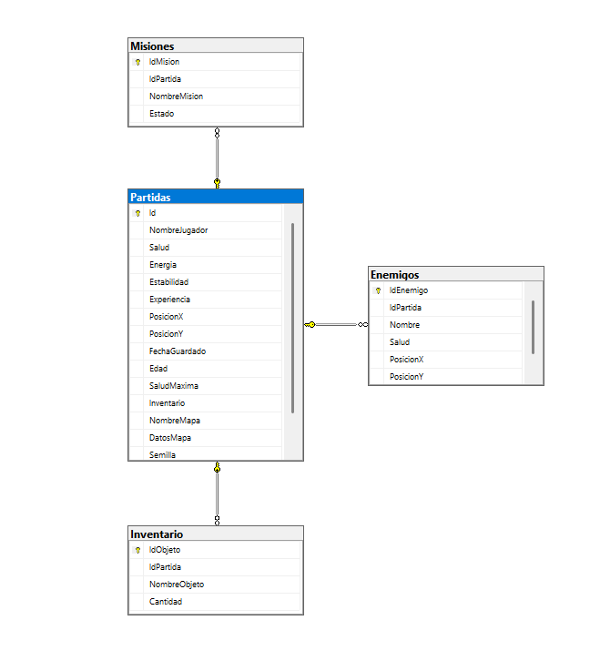
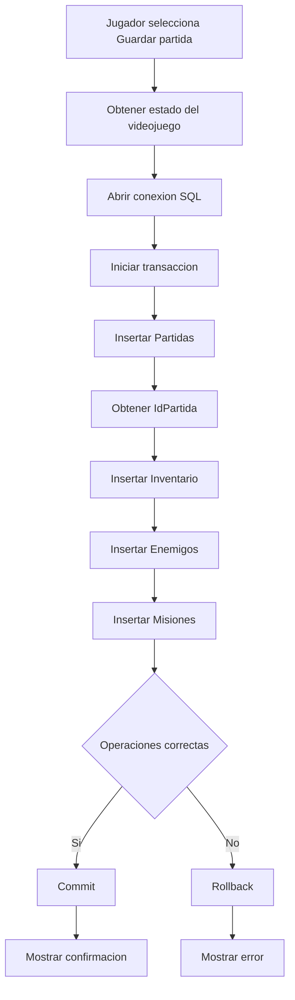
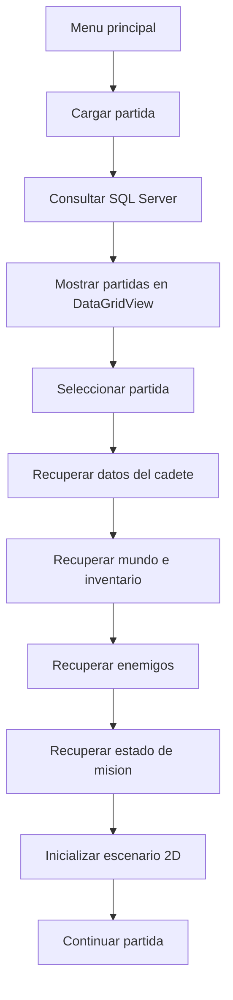
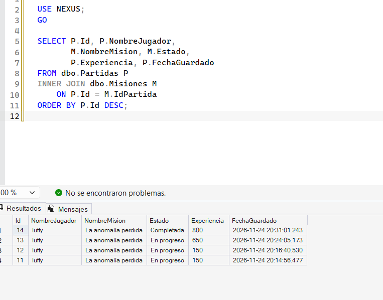

# Modelo de datos propuesto para NEXUS

**Documento:** Modelo de datos del software  
**Versión:** 2.0  
**Proyecto:** NEXUS  
**Motor de base de datos:** SQL Server Express  
**Base de datos:** NEXUS  
**Tecnología de acceso:** ADO.NET y Microsoft.Data.SqlClient  
**Estado:** Modelo implementado con propuestas de mejora.

---

## 1. Introducción

Durante H3, NEXUS funcionaba como una aplicación de consola en la que los datos del jugador se almacenaban temporalmente en memoria.

Al cerrar la aplicación, el progreso obtenido durante la partida se perdía.

Para solucionar esta limitación, se planteó incorporar un sistema de persistencia mediante una base de datos relacional.

Actualmente, NEXUS utiliza SQL Server para almacenar los atributos del cadete, el mundo generado, las coordenadas del jugador, el inventario, los enemigos y el estado de las misiones.

El presente documento describe el modelo implementado y establece propuestas para mejorar su integridad, organización y escalabilidad.

---

## 2. Objetivo general

Diseñar y mantener un modelo de datos relacional que permita almacenar y recuperar el progreso del jugador, garantizando la consistencia de la información mediante SQL Server.

### 2.1. Objetivos específicos

- Almacenar los atributos del cadete.
- Registrar el progreso de las partidas.
- Conservar los objetos del inventario.
- Registrar los enemigos y su estado.
- Almacenar las misiones y su progreso.
- Recuperar partidas previamente guardadas.
- Garantizar la integridad referencial.
- Utilizar transacciones para evitar registros incompletos.
- Facilitar futuras ampliaciones del videojuego.

---

## 3. Tecnologías utilizadas

| Tecnología | Responsabilidad |
|---|---|
| SQL Server Express | Motor de base de datos |
| SQL Server Management Studio | Administración y consulta de registros |
| C# | Desarrollo de la lógica del videojuego |
| Microsoft.Data.SqlClient | Comunicación entre C# y SQL Server |
| ADO.NET | Ejecución de operaciones de acceso a datos |
| Windows Forms | Interfaz de guardado y recuperación |
| DataGridView | Visualización de partidas almacenadas |
| JSON | Representación serializada de determinados datos |

La persistencia se realiza mediante la clase `PartidaSQL`, ubicada en el archivo `partidasSQL.cs`.

---

## 4. Modelo relacional actual

La base de datos NEXUS contiene cuatro tablas principales:

1. Partidas.
2. Inventario.
3. Enemigos.
4. Misiones.

La tabla `Partidas` representa la entidad principal del modelo.

Las tablas restantes se relacionan con ella mediante claves foráneas.

| Entidad | Descripción |
|---|---|
| Partidas | Almacena los datos generales del jugador y su progreso |
| Inventario | Registra los objetos y cantidades de cada partida |
| Enemigos | Registra los enemigos, su salud y ubicación |
| Misiones | Registra los objetivos y su estado |

---

## 5. Diccionario de datos

### 5.1. Tabla Partidas

Almacena la información principal de cada partida guardada.

| Campo | Tipo de dato SQL | Descripción |
|---|---|---|
| Id | INT | Clave primaria autoincremental |
| NombreJugador | NVARCHAR(50) | Nombre del cadete |
| Edad | INT | Edad del personaje |
| Salud | INT | Salud actual |
| SaludMaxima | INT | Salud máxima |
| Energia | INT | Energía disponible |
| Estabilidad | INT | Estabilidad del cadete |
| Experiencia | INT | Puntos de experiencia acumulados |
| PosicionX | INT | Coordenada horizontal |
| PosicionY | INT | Coordenada vertical |
| Inventario | NVARCHAR(MAX) | Inventario serializado en JSON |
| NombreMapa | NVARCHAR(100) | Nombre del mundo |
| DatosMapa | NVARCHAR(MAX) | Campo disponible para datos del mapa |
| Semilla | INT | Semilla utilizada para el mundo |
| Enemigos | NVARCHAR(MAX) | Campo disponible para datos de enemigos |
| FechaGuardado | DATETIME | Fecha y hora de almacenamiento |

**Clave primaria:** `Id`.

Los campos `DatosMapa` y `Enemigos` permanecen definidos en el esquema SQL, aunque el método actual de guardado no los completa explícitamente.

Los enemigos se almacenan mediante la tabla relacional `Enemigos`.

### 5.2. Tabla Inventario

Almacena los objetos asociados a una partida.

| Campo | Tipo de dato SQL | Descripción |
|---|---|---|
| IdObjeto | INT | Clave primaria autoincremental |
| IdPartida | INT | Clave foránea de Partidas |
| NombreObjeto | NVARCHAR(100) | Nombre del objeto |
| Cantidad | INT | Número de unidades |

**Clave primaria:** `IdObjeto`.

**Clave foránea:** `IdPartida`.

El sistema agrupa los objetos repetidos antes de almacenarlos.

Por ejemplo, si el jugador dispone de tres células de energía, se registra el nombre del objeto y su cantidad correspondiente.

La tabla contiene una restricción que establece que la cantidad debe ser mayor que cero.

### 5.3. Tabla Enemigos

Almacena el estado de los enemigos asociados a una partida.

| Campo | Tipo de dato SQL | Descripción |
|---|---|---|
| IdEnemigo | INT | Clave primaria autoincremental |
| IdPartida | INT | Clave foránea de Partidas |
| Nombre | NVARCHAR(100) | Nombre del enemigo |
| Salud | INT | Salud actual |
| PosicionX | REAL | Coordenada horizontal |
| PosicionY | REAL | Coordenada vertical |

**Clave primaria:** `IdEnemigo`.

**Clave foránea:** `IdPartida`.

Esta tabla permite recuperar los enemigos guardados y conservar su estado dentro del escenario.

### 5.4. Tabla Misiones

Almacena el progreso de las misiones.

| Campo | Tipo de dato SQL | Descripción |
|---|---|---|
| IdMision | INT | Clave primaria autoincremental |
| IdPartida | INT | Clave foránea de Partidas |
| NombreMision | NVARCHAR(100) | Nombre de la misión |
| Estado | NVARCHAR(50) | Estado de la misión |

**Clave primaria:** `IdMision`.

**Clave foránea:** `IdPartida`.

Actualmente, NEXUS registra la misión principal denominada:

**La anomalía perdida.**

Los estados utilizados por el código son:

- En progreso.
- Completada.

---

## 6. Diagrama entidad-relación



El diagrama representa las entidades y relaciones definidas en el script SQL actual.

### Evidencia del modelo implementado



La imagen corresponde al diagrama de relaciones de la base de datos de NEXUS.

---

## 7. Relaciones entre entidades

### 7.1. Partidas e Inventario

**Relación:** Uno a muchos (1:N).

Una partida puede contener diferentes objetos.

Cada registro del inventario pertenece a una partida determinada.

### 7.2. Partidas y Enemigos

**Relación:** Uno a muchos (1:N).

Una partida puede contener múltiples enemigos.

Cada enemigo almacenado pertenece a una partida específica.

### 7.3. Partidas y Misiones

**Relación:** Uno a muchos (1:N).

Una partida puede almacenar múltiples registros de misiones.

Actualmente, la aplicación utiliza una misión principal.

| Tabla principal | Tabla relacionada | Cardinalidad |
|---|---|---|
| Partidas | Inventario | 1:N |
| Partidas | Enemigos | 1:N |
| Partidas | Misiones | 1:N |

---

## 8. Integridad referencial

La integridad referencial permite mantener la consistencia entre las tablas relacionadas.

El script SQL contiene las siguientes claves foráneas:

- `FK_Inventario_Partidas`.
- `FK_Enemigos_Partidas`.
- `FK_Misiones_Partidas`.

Estas restricciones impiden registrar objetos, enemigos o misiones asociados a una partida inexistente.

También se utilizan claves primarias autoincrementales para identificar individualmente los registros.

---

## 9. Correspondencia entre C# y SQL Server

| Componente de C# | Información almacenada |
|---|---|
| Cadete.Nombre | Partidas.NombreJugador |
| Cadete.Edad | Partidas.Edad |
| Cadete.Salud | Partidas.Salud |
| Cadete.SaludMaxima | Partidas.SaludMaxima |
| Cadete.Energia | Partidas.Energia |
| Cadete.Estabilidad | Partidas.Estabilidad |
| Cadete.Experiencia | Partidas.Experiencia |
| Cadete.Inventario | Partidas.Inventario y tabla Inventario |
| Coordenadas del jugador | Partidas.PosicionX y PosicionY |
| Nombre del mundo | Partidas.NombreMapa |
| Semilla del mundo | Partidas.Semilla |
| Enemigo2D | Tabla Enemigos |
| Estado de misión | Tabla Misiones |

La correspondencia permite trasladar la información de los objetos de C# hacia la base de datos relacional.

---

## 10. Estrategia de almacenamiento del mundo

NEXUS utiliza escenarios 2D y almacena información relacionada con el mundo de cada partida.

Los principales datos son:

- Nombre del mundo.
- Semilla.
- Posición del jugador.
- Posición de los enemigos.
- Salud de los enemigos.
- Estado de la misión.

La semilla permite identificar la configuración utilizada para generar el escenario.

Sin embargo, no debe suponerse que todos los elementos aleatorios pueden reconstruirse únicamente mediante la semilla.

Por esta razón, el sistema también almacena individualmente los enemigos y sus coordenadas.

Como mejora futura, se propone guardar cualquier modificación adicional del escenario que no pueda reconstruirse a partir de los datos existentes.

---

## 11. Conexión con SQL Server

La clase `PartidaSQL` utiliza `SqlConnection` para establecer la comunicación con SQL Server.

La configuración actual es:

```csharp
private const string cadenaConexion =
    @"Server=.\SQLEXPRESS;Database=NEXUS;Integrated Security=True;TrustServerCertificate=True;";
```

La conexión utiliza:

- Una instancia local de SQL Server Express.
- La base de datos NEXUS.
- Autenticación integrada de Windows.

El método `ObtenerConexion()` permite crear una conexión para ejecutar las operaciones correspondientes.

Como mejora futura, se propone trasladar esta configuración a un archivo externo para facilitar la ejecución en otros equipos.

---

## 12. Operaciones de persistencia

La clase `PartidaSQL` contiene los siguientes métodos:

| Método | Función |
|---|---|
| ObtenerConexion() | Crear una conexión SQL |
| ProbarConexion() | Comprobar la disponibilidad de la conexión |
| GuardarPartida() | Registrar el progreso |
| ObtenerPartidas() | Consultar partidas almacenadas |
| CargarPartida() | Recuperar una partida por identificador |
| CargarMision() | Consultar el estado de la misión |
| CargarEnemigos() | Recuperar enemigos relacionados |

Estas operaciones permiten establecer la comunicación entre la lógica del videojuego y la base de datos.

---

## 13. Proceso de guardado de partidas

El guardado se realiza mediante el método `GuardarPartida()`.

El procedimiento actual consiste en:

1. Recibir los datos del cadete y del mundo.
2. Abrir una conexión con SQL Server.
3. Iniciar una transacción.
4. Insertar los datos en la tabla Partidas.
5. Recuperar el identificador generado.
6. Serializar y agrupar los objetos del inventario.
7. Registrar los objetos relacionados.
8. Registrar los enemigos.
9. Registrar el estado de la misión.
10. Confirmar la transacción.

Actualmente, cada guardado genera un nuevo registro en la tabla `Partidas`.

Esto permite conservar diferentes puntos de guardado del jugador.

### 13.1. Diagrama del proceso



---

## 14. Uso de transacciones

El sistema utiliza `SqlTransaction` para garantizar que las operaciones relacionadas con una partida se ejecuten como una unidad.

Ejemplo simplificado del mecanismo implementado:

```csharp
using SqlTransaction transaccion =
    conexion.BeginTransaction();

try
{
    // Ejecutar las operaciones de guardado.

    transaccion.Commit();
}
catch
{
    transaccion.Rollback();
    throw;
}
```

### Commit

Confirma las operaciones realizadas dentro de la transacción.

### Rollback

Revierte las operaciones cuando ocurre un error antes de confirmar la transacción.

Esto evita que una partida quede almacenada parcialmente si falla el registro del inventario, los enemigos o las misiones.

---

## 15. Recuperación de partidas

La recuperación permite continuar una partida previamente almacenada.

El procedimiento general es:

1. El jugador selecciona Cargar partida.
2. El sistema consulta los registros disponibles.
3. Las partidas se muestran mediante DataGridView.
4. El jugador selecciona un registro.
5. El sistema obtiene el identificador de la partida.
6. Se recuperan los atributos del cadete.
7. Se recuperan los datos del mundo.
8. Se reconstruye el inventario.
9. Se recuperan los enemigos.
10. Se consulta el estado de la misión.
11. Se inicializa el escenario 2D.

### 15.1. Diagrama de recuperación



---

## 16. Operaciones CRUD

CRUD representa las operaciones básicas de una base de datos:

- Create: crear registros.
- Read: consultar registros.
- Update: actualizar registros.
- Delete: eliminar registros.

| Operación | Comando SQL | Estado en NEXUS |
|---|---|---|
| Create | INSERT | Implementado |
| Read | SELECT | Implementado |
| Update | UPDATE | Propuesto para futuras mejoras |
| Delete | DELETE | Propuesto para futuras mejoras |

Actualmente, NEXUS permite insertar nuevas partidas y recuperar registros existentes.

Como ampliación futura, se propone permitir actualizar un punto de guardado existente y eliminar partidas desde la interfaz gráfica.

---

## 17. Consultas SQL de verificación

### 17.1. Consultar partidas

```sql
USE NEXUS;

SELECT *
FROM dbo.Partidas
ORDER BY FechaGuardado DESC;
```

### 17.2. Consultar inventario

```sql
SELECT *
FROM dbo.Inventario;
```

### 17.3. Consultar enemigos

```sql
SELECT *
FROM dbo.Enemigos;
```

### 17.4. Consultar misiones

```sql
SELECT *
FROM dbo.Misiones;
```

### 17.5. Consultar partidas y progreso de misiones

```sql
SELECT
    P.Id,
    P.NombreJugador,
    M.NombreMision,
    M.Estado,
    P.Experiencia,
    P.FechaGuardado
FROM dbo.Partidas P
INNER JOIN dbo.Misiones M
    ON P.Id = M.IdPartida
ORDER BY P.Id DESC;
```

La última consulta permite verificar la relación entre las partidas almacenadas y sus respectivas misiones.

### Evidencia de consulta



---

## 18. Normalización y consistencia

El modelo utiliza tablas relacionadas para organizar diferentes tipos de información.

La separación entre partidas, inventario, enemigos y misiones permite consultar los datos de manera individual.

Sin embargo, el inventario actualmente se almacena de dos formas:

- Como información serializada en JSON dentro de Partidas.
- Como registros relacionados en la tabla Inventario.

Esta duplicación puede generar inconsistencias si en el futuro se modifica una representación sin actualizar la otra.

Se propone utilizar la tabla Inventario como fuente principal de información y adaptar progresivamente el proceso de recuperación.

También se propone revisar los campos `DatosMapa` y `Enemigos` de la tabla Partidas para determinar si deben conservarse, utilizarse o eliminarse mediante una migración controlada.

---

## 19. Reglas de integridad propuestas

Se propone reforzar las validaciones de la aplicación mediante restricciones SQL.

| Campo | Regla propuesta |
|---|---|
| Edad | Entre 16 y 100 años |
| Salud | Mayor o igual a cero y no superior a SaludMaxima |
| SaludMaxima | Mayor que cero |
| Energia | Entre 0 y 100 |
| Estabilidad | Entre 0 y 100 |
| Experiencia | Mayor o igual a cero |
| Cantidad | Mayor que cero |
| NombreJugador | No vacío |
| Estado | En progreso o Completada |

La restricción de cantidad mayor que cero ya se encuentra implementada en la tabla Inventario.

Las demás restricciones deberán revisarse e incorporarse progresivamente, verificando previamente su compatibilidad con los registros existentes.

Ejemplos de restricciones propuestas:

```sql
ALTER TABLE dbo.Partidas
ADD CONSTRAINT CK_Partidas_Energia
CHECK (Energia BETWEEN 0 AND 100);

ALTER TABLE dbo.Partidas
ADD CONSTRAINT CK_Partidas_Estabilidad
CHECK (Estabilidad BETWEEN 0 AND 100);

ALTER TABLE dbo.Partidas
ADD CONSTRAINT CK_Partidas_Experiencia
CHECK (Experiencia >= 0);
```

Estos comandos representan mejoras futuras y no forman parte del script original revisado.

---

## 20. Seguridad de la información

### 20.1. Consultas parametrizadas

NEXUS utiliza parámetros mediante `SqlCommand`.

Ejemplo:

```csharp
comando.Parameters.AddWithValue(
    "@Nombre", cadete.Nombre);
```

Esto evita concatenar directamente los valores ingresados por el usuario dentro de las consultas SQL.

### 20.2. Autenticación

La conexión actual utiliza autenticación integrada de Windows.

### 20.3. Configuración externa

Se propone almacenar la cadena de conexión fuera del código fuente.

### 20.4. Manejo de excepciones

El sistema debe informar cuando una operación de almacenamiento no pueda completarse.

### 20.5. Copias de seguridad

Se propone realizar copias de seguridad periódicas de la base de datos para evitar la pérdida de información.

### 20.6. Certificados

La configuración actual utiliza `TrustServerCertificate=True`.

Esta configuración facilita el desarrollo local, pero para una implementación en red o producción se recomienda utilizar certificados confiables y validar la identidad del servidor.

---

## 21. Limitaciones actuales

### 21.1. Guardados independientes

Cada operación de guardado genera una nueva partida almacenada.

Se propone incorporar una opción para actualizar un punto de guardado existente.

### 21.2. Duplicación de información

El inventario se representa mediante JSON y registros relacionales.

Se recomienda definir una fuente principal de información.

### 21.3. Precisión de coordenadas

Las coordenadas del jugador se convierten a valores enteros al guardarse.

Los enemigos utilizan coordenadas de tipo REAL.

Se propone unificar la precisión de las coordenadas si resulta necesario para recuperar posiciones con mayor exactitud.

### 21.4. Misiones

Actualmente se registra una misión principal.

Se propone ampliar el sistema para gestionar múltiples objetivos y recompensas.

### 21.5. Configuración de conexión

La instancia SQL Server se encuentra definida directamente en el código.

Se recomienda utilizar una configuración externa.

### 21.6. Script de instalación

El script comprueba si existe la base de datos antes de crearla.

Sin embargo, las instrucciones de creación de tablas no comprueban individualmente si estas ya existen.

Se propone mejorar el script para facilitar su ejecución repetida sin generar errores por objetos existentes.

---

## 22. Propuesta de ampliación futura

Cuando el videojuego requiera nuevas funcionalidades, se podrán incorporar entidades adicionales.

| Entidad propuesta | Finalidad |
|---|---|
| Cadetes | Separar los perfiles de los puntos de guardado |
| Mundos | Administrar configuraciones de escenarios |
| CatalogoObjetos | Definir tipos y efectos de objetos |
| CatalogoMisiones | Administrar múltiples misiones |
| Equipamiento | Registrar armas, escudos y accesorios |
| HistorialCombate | Registrar resultados de combates |

Estas entidades representan ampliaciones futuras.

No se encuentran implementadas actualmente y no son necesarias para el funcionamiento básico del sistema de persistencia existente.

---

## 23. Plan de verificación

| Prueba | Resultado esperado |
|---|---|
| Crear una partida | Inicializar los datos del cadete |
| Guardar progreso | Registrar una nueva partida |
| Guardar inventario | Registrar objetos y cantidades |
| Guardar enemigos | Conservar salud y posiciones |
| Guardar misión | Registrar su estado |
| Cerrar la aplicación | Mantener los datos almacenados |
| Cargar partida | Recuperar el progreso |
| Consultar SQL Server | Visualizar registros relacionados |
| Simular un error SQL | Evitar un guardado parcial |
| Registrar cantidad inválida | Rechazar el valor mediante la restricción existente |

La tabla establece los resultados esperados para verificar la persistencia.

Las pruebas adicionales de errores y restricciones deberán ejecutarse antes de considerarlas verificadas.

---

## 24. Estado de implementación

| Componente | Estado |
|---|---|
| Base de datos NEXUS | Implementado |
| Tabla Partidas | Implementado |
| Tabla Inventario | Implementado |
| Tabla Enemigos | Implementado |
| Tabla Misiones | Implementado |
| Claves primarias | Implementado |
| Claves foráneas | Implementado |
| Consultas parametrizadas | Implementado |
| Transacciones | Implementado |
| Guardado de partidas | Implementado |
| Recuperación de partidas | Implementado |
| Visualización mediante DataGridView | Implementado |
| Actualización de partidas existentes | Propuesto |
| Eliminación de partidas | Propuesto |
| Restricciones adicionales | Propuesto |
| Catálogos independientes | Propuesto |
| Configuración externa | Propuesto |

---

## 25. Evidencias del modelo de datos

Las evidencias relacionadas con el funcionamiento de SQL Server y la persistencia se encuentran en:

[Carpeta de evidencias](evidencias/)

Archivos principales:

- [Diagrama entidad-relación](evidencias/diagrama-modelo-datos.png)
- [Consulta de registros SQL](evidencias/base-de-datos.png)
- Captura del guardado de partidas.
- Captura de la carga de partidas.
- Captura del progreso recuperado.
- Captura de la misión completada.

---

## 26. Referencias internas

- [Script de base de datos](../sql/nexus.sql)
- [Clase de acceso a datos](../partidasSQL.cs)
- [Clases principales](../Program.cs)
- [Juego 2D](../juego2d.cs)
- [Formulario de carga](../cargarpartidas.cs)
- [Arquitectura actual](arquitectura-actual.md)
- [Arquitectura propuesta](arquitectura-propuesta.md)
- [Diseño del videojuego](diseno-del-juego.md)

## 27. Fuentes técnicas de consulta

- [SQL Server - Microsoft Learn](https://learn.microsoft.com/en-us/sql/sql-server/)
- [Claves primarias y foráneas](https://learn.microsoft.com/en-us/sql/relational-databases/tables/primary-and-foreign-key-constraints)
- [ADO.NET](https://learn.microsoft.com/en-us/dotnet/framework/data/adonet/)
- [Microsoft.Data.SqlClient](https://learn.microsoft.com/en-us/sql/connect/ado-net/introduction-microsoft-data-sqlclient)
- [Transacciones locales](https://learn.microsoft.com/en-us/dotnet/framework/data/adonet/local-transactions)
- [Serialización JSON en .NET](https://learn.microsoft.com/en-us/dotnet/standard/serialization/system-text-json/overview)

---

## 28. Conclusión

El modelo de datos de NEXUS permite almacenar y recuperar el progreso del videojuego mediante SQL Server.

La utilización de las tablas Partidas, Inventario, Enemigos y Misiones permite organizar la información y establecer relaciones mediante claves primarias y foráneas.

La implementación de consultas parametrizadas y transacciones contribuye a mantener la seguridad y consistencia de las operaciones de almacenamiento.

Las mejoras propuestas permitirán ampliar las funcionalidades del videojuego, reducir la duplicación de información y facilitar el mantenimiento de la base de datos.

El modelo constituye una evolución del proyecto desarrollado durante H3 y se encuentra relacionado directamente con las clases, formularios y operaciones de persistencia existentes en el repositorio de NEXUS.
