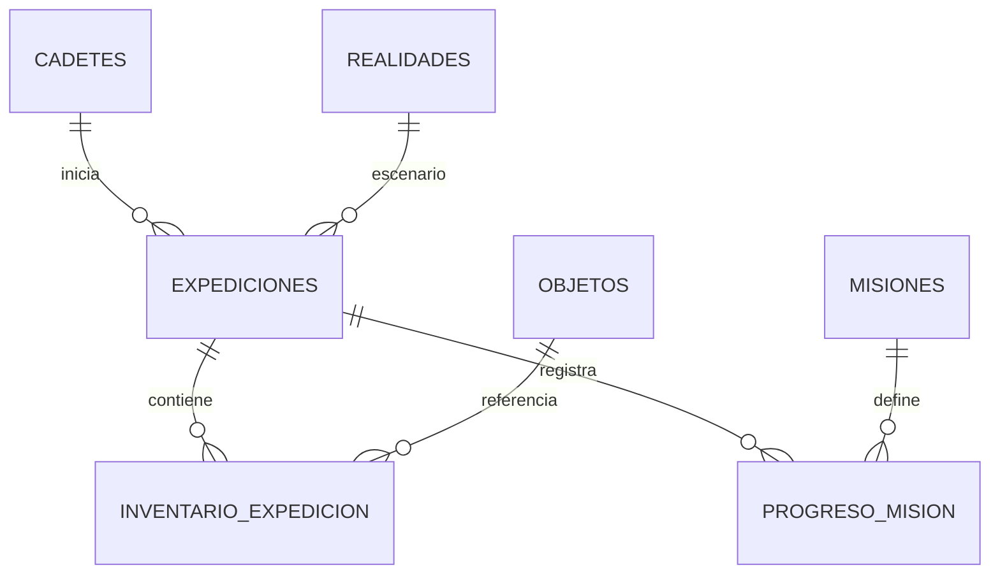

# Modelo de datos propuesto para NEXUS

**Estado:** modelo lógico propuesto; todavía no hay tablas SQL implementadas. Motor: SQL Server con EF Core 10.

## 1. Objetivo

Guardar el progreso necesario para continuar una partida: cadete, realidad, posición, indicadores, experiencia, misión e inventario. Se guardan puntos de control y no cada pulsación de tecla.

## 2. Entidades

| Tabla | Campos principales | Función |
|---|---|---|
| `Cadetes` | `CadeteId` PK, `Nombre`, `Edad`, `FechaRegistro` | Perfil del jugador. |
| `Realidades` | `RealidadId` PK, `Codigo` único, `Nombre`, `Filas`, `Columnas`, `MapaInicialJson` | Catálogo Alpha, Beta y Gamma y mapa base. |
| `Expediciones` | `ExpedicionId` PK, `CadeteId` FK, `RealidadId` FK, `Estado`, fechas, `Salud`, `Energia`, `Estabilidad`, `Experiencia`, `PosX`, `PosY`, `MisionCompletada`, `Version` | Partida y último punto de control. |
| `Objetos` | `ObjetoId` PK, `Codigo` único, `Nombre`, `Descripcion`, `Tipo`, `ValorEfecto` | Catálogo de objetos. |
| `InventarioExpedicion` | `ExpedicionId` PK/FK, `ObjetoId` PK/FK, `Cantidad` | Objetos y cantidades de una partida. |
| `Misiones` | `MisionId` PK, `Codigo` único, `Nombre`, `Descripcion`, `RecompensaXP` | Definición de misión. |
| `ProgresoMision` | `ExpedicionId` PK/FK, `MisionId` PK/FK, `Estado`, fechas | Progreso de cada misión por partida. |

## 3. Relaciones



Un cadete puede iniciar muchas expediciones. Cada expedición usa una realidad. El inventario es una relación muchos-a-muchos entre expediciones y objetos, resuelta por `InventarioExpedicion`. `ProgresoMision` conecta una expedición con sus misiones.

## 4. Integridad y reglas

- Edad entre 16 y 100, según validación actual.
- Salud, energía y estabilidad entre 0 y 100.
- Coordenadas no negativas y dentro de las dimensiones de la realidad.
- Cantidad de objeto mayor que cero.
- Códigos únicos en catálogos.
- Estado limitado a `EnCurso`, `Completada` o `Fallida`.
- `FechaFin` nula mientras la expedición esté en curso.
- La aplicación debe validar coordenadas contra la realidad; restricciones CHECK pueden reforzar rangos simples.

## 5. Estrategia para el mapa

En la primera versión, almacenar el mapa base como JSON en `Realidades.MapaInicialJson` es razonable porque las tres matrices actuales son pequeñas y estáticas. La aplicación lo deserializa para reconstruir `MapaRealidad`.

Si luego se requiere editar mapas o consultar casillas individualmente, se puede migrar a tablas `Mapas` y `CasillasMapa` con clave compuesta (MapaId, Fila, Columna). Si una partida modifica celdas, se puede agregar `EstadoMapaJson` en `Expediciones` para guardar el estado particular.

## 6. Guardar progreso

1. Validar estado del cadete y posición en memoria.
2. Abrir un contexto EF Core.
3. Actualizar `Expediciones`.
4. Sincronizar `InventarioExpedicion` y `ProgresoMision`.
5. Ejecutar `SaveChangesAsync()`.
6. Si falla, informar y permitir reintentar; no marcar el progreso como guardado.

EF Core aplica los cambios de una llamada a `SaveChanges` dentro de una transacción cuando el proveedor admite transacciones. Si se hacen varias llamadas para una operación lógica, usar una transacción explícita.

## 7. Recuperar progreso

1. “Continuar” busca la expedición más reciente en estado `EnCurso`.
2. Carga realidad, posición, indicadores, inventario y progreso de misión.
3. Reconstruye `Cadete`, `MapaRealidad` y estado de sesión.
4. Valida rangos y coordenadas.
5. Si no existe partida en curso, ofrece iniciar una nueva.

Guardar después de movimientos válidos, recogida/uso de objetos, final de combate y cambios de misión. No guardar movimientos bloqueados ni simples cambios de pantalla.

## 8. Seguridad y concurrencia

- No concatenar entradas del jugador en SQL.
- Mantener cadenas de conexión fuera del código y del repositorio público.
- Usar permisos mínimos para el usuario de base de datos.
- No guardar información personal que no sea necesaria.
- Un campo `Version` puede servir como token de concurrencia si se permite abrir la misma partida desde más de una sesión.
- LocalDB es para desarrollo local; para compartir datos entre equipos se requiere una instancia SQL Server accesible en red.

## 9. Tecnología

Usar `Microsoft.EntityFrameworkCore.SqlServer` 10.x con EF Core 10 y .NET 10. Configurar el contexto mediante `UseSqlServer(connectionString)`. EF Core Migrations permite mantener el esquema sincronizado con el modelo C#.

Ejemplo conceptual (no agregado al proyecto):

```csharp
services.AddDbContext<NexusDbContext>(options =>
    options.UseSqlServer(
        configuration.GetConnectionString("NexusDatabase")));
```

No escribir una cadena de conexión con credenciales dentro del repositorio.

## 10. Primera versión viable

Implementar primero `Cadetes`, `Realidades` y `Expediciones`; después objetos/inventario y el progreso de la misión principal. Probar el ciclo: crear partida, guardar, cerrar, abrir y recuperar el mismo estado.

## 11. Fuentes técnicas

- [Proveedor SQL Server para EF Core](https://learn.microsoft.com/en-us/ef/core/providers/sql-server/)
- [Transacciones en EF Core](https://learn.microsoft.com/en-us/ef/core/saving/transactions)
- [Migraciones en EF Core](https://learn.microsoft.com/en-us/ef/core/managing-schemas/migrations)
- [SQL Server Express LocalDB](https://learn.microsoft.com/en-us/sql/database-engine/configure-windows/sql-server-express-localdb)
- [Novedades de EF Core 10 y requisito de .NET 10](https://learn.microsoft.com/en-us/ef/core/what-is-new/ef-core-10.0/whatsnew)
